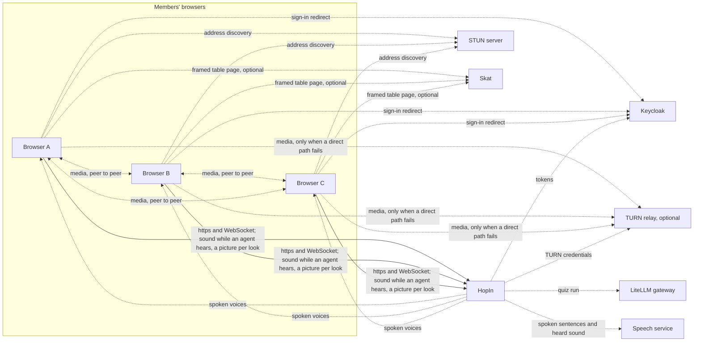
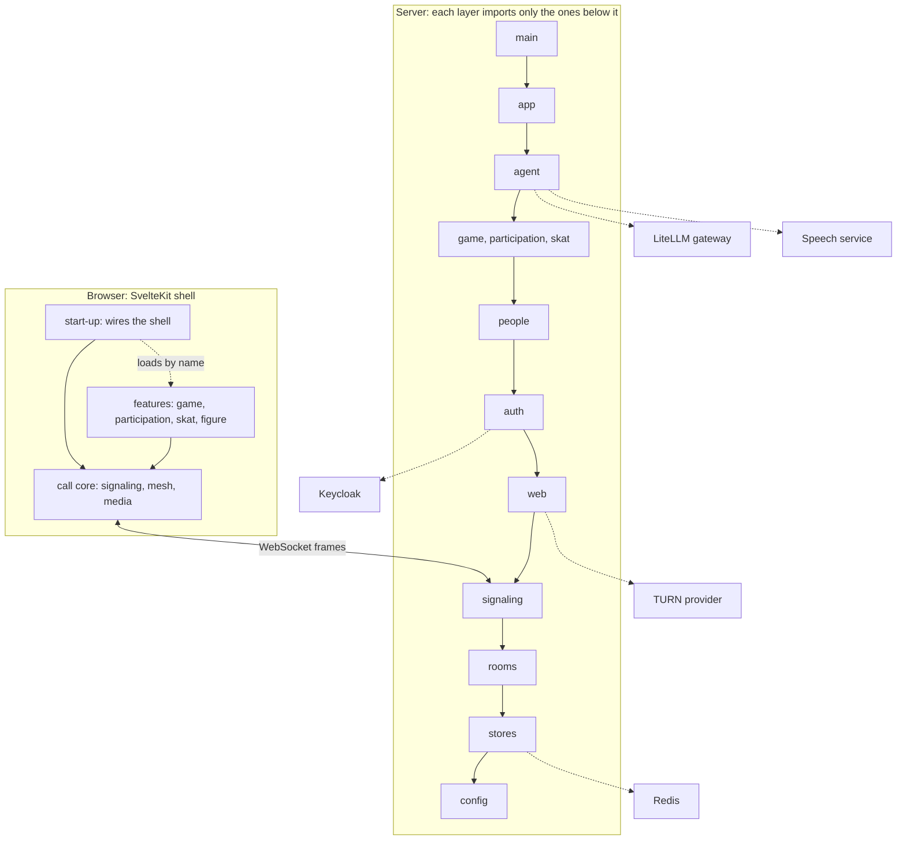
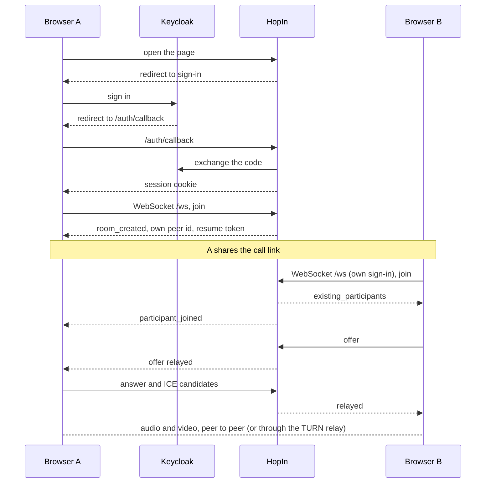
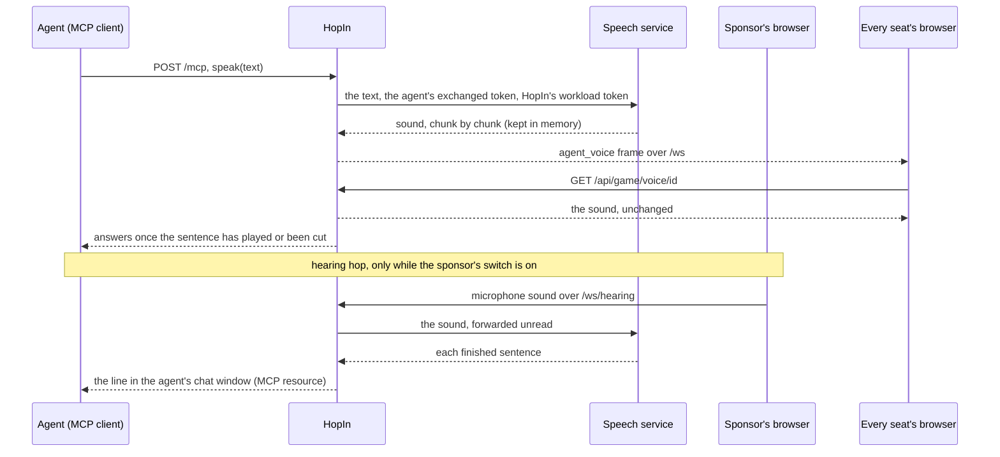

# HopIn Architecture

How HopIn is built, how a call runs and what it trusts. For what HopIn is and how to run it, see the [README](../README.md). Each package states its own rules in its docstring or header; a call's rules, each with its test, are in [docs/call.md](call.md).

## 1. Context and Scope

A call is a full mesh: every browser sends its media straight to every other browser, or through a TURN relay when the operator has switched it on and a direct path fails. The camera video and the sound between people never pass the server. Three other things do: the spoken sentences of the game master and the agents, which the server has the speech service render and serves to each browser; while an agent hears a person, that person's microphone sound, forwarded unread to the speech service; and, when an agent the person lets see looks, one still picture of their camera, held in memory only until the agent has it. The server signs people in, hands out rooms and relays the setup messages, chat lines and media state between the members of one room.

Caption: who talks to whom, from `auth/`, `web/turn_relay.py` and `agent/`. The session gate (`auth/gate.py`) stands in front of every route and `/ws`.

## 2. Building Block View

Caption: parts and what each may import, from the `layers` contract in `pyproject.toml` (`errors` and `words` stand in the bottom layers) and `frontend/src/lib/`. A dashed arrow leaves HopIn.

| Package | Job |
|---|---|
| `config` | settings, constants, enums and the secret-file reader |
| `stores` | the Redis every process shares and the port `create_app` takes |
| `rooms` | rooms, participants, the places people and agents share, the lock |
| `signaling` | the WebSocket: identity, frames, seats, replay, timers, the feature port |
| `web` | the page build, the request's language, health, the ICE server list |
| `auth` | sign-in against Keycloak through webauth and the session gate |
| `people` | the admin download of what HopIn holds about one person |
| `game` | optional: one quiz per call |
| `participation` | optional: the agents a person dials in, with no AI in it |
| `skat` | optional: the Skat table a call shows |
| `agent` | optional connector: the MCP surface of a person's agents and the quiz agent; the only speaker to LiteLLM and the speech service |
| `app` | the composition root: wires the packages, names no feature |
| `main` | starts the server and switches the optional features in |

The feature port is `TransitionFeature` in `signaling`: each optional feature plugs into it and runs on transitions, so the call core compiles and runs without any of them. The browser mirrors it: `GET /api/call-features` names the wired features, and the shell imports them before signaling connects.

`make frontend` builds the page into `src/hopin/web/build/`; the server refuses to start without it.

## 3. Runtime View

An agent's turn, from the MCP tool to the people who hear it, and the other way round:

Caption: from `agent/tools.py`, `participation/speaking.py`, `agent/speaking.py`, `agent/hearing_route.py` and `participation/speech_in_windows.py`.

The rules of a room (host, lock, resume window, host grace, Skat table, quiz run, hearing hop, speaking queue) are in [docs/call.md](call.md). The frames and their limits are in `src/hopin/signaling/__init__.py`.

## 4. Deployment View

One container, built from `Dockerfile`, runs as the one pod of the `hopin` namespace on the platform (k3s with Flux) from its attested private GHCR image. The platform's repository owns the manifests under `apps/hopin/`, which hold the live settings; secret files come from `platform-secrets` under `/run/secrets`. The Cloudflare tunnel terminates https and runs through Traefik to HopIn on 8080; readiness is `GET /health`. Keycloak's back-channel logout does not reach HopIn there, so a sign-out at Keycloak ends a HopIn session only at its 12-hour lifetime ([platform#46](https://github.com/overnightworks/platform/issues/46)). `compose.yaml` serves only the rollback path on hal, behind the edge reverse proxy.

Every process reaches one Redis at `HOPIN_REDIS_URL`, which holds the rate limit windows and the agent connector's member-place signals; the server refuses to start without it and `/health` is not ready while it does not answer. All other state lives in process memory, so a restart ends every call and session; there is no database.

## 5. Crosscutting Concepts

**Sign-in and sessions.** webauth runs the OIDC code flow against Keycloak and the gate admits the members of `/apps/hopin` (`src/hopin/auth/__init__.py`).

**Limits.** Request budgets, the body cap and the origin check are webauth's, set in `config/web_policy.py`; the windows live in Redis.

**Headers.** webauth's Content-Security-Policy with the build's script and style hashes, a Permissions-Policy and the build's cache rules (`web/page_build.py`).

**Persistence.** Nothing outlasts a restart except Redis's rate limit windows and the connector's place records. What HopIn holds about a person is in the README under A Person's Data.

**Deadlines.** Every timer that outlives a connection is a named deadline behind the `Deadlines` port (`signaling/scheduler.py`). **Logging.** The conventions are in the docstring of `src/hopin/main.py`.

**Proof.** Python tests under `tests/` judge logic per package; Vitest judges the browser's logic; Playwright end-to-end tests drive the built page, the start-up module and the `.svelte` files; the shared-stores job runs two processes against one Redis. CI merges their coverage into one report and judges it at 100 %. Import-linter contracts and `make wire-check` prove structure, and the removal drill (`scripts/remove_feature.py`) proves the call survives each feature's deletion. [docs/call.md](call.md) maps each rule to its test.

### Trust

Each line: what the party sees and what HopIn trusts of it. 

- **A member's browser** sends chat, media state and connection descriptions with a session; HopIn trusts none beyond the session: names come from the Keycloak account, senders are server-minted peer ids, host actions are checked against the account.
- **Anyone without a session** reaches the sign-in routes and a few static files only (`auth/gate.py`); HopIn trusts nothing they send.
- **Keycloak** decides who is a member and admin; HopIn trusts its signed tokens from the one issuer, and its logout token to end sessions, so that route stays off the public internet.
- **The proxy hops** in `HOPIN_TRUSTED_PROXIES` are trusted to state the person's address in `X-Forwarded-For`; empty trusts none.
- **The other members of a call** see each other's addresses and relayed frames; they cannot address people outside their room or act as host.
- **The STUN server** learns each asking browser's address; a wrong answer at worst prevents a connection.
- **The TURN provider** sees who connects to whom, when and how much, never media content; HopIn trusts only its credential answer, over https, and it bills the operator.
- **Skat's frame** is a sandboxed page of another origin; it cannot use camera, microphone or screen, and HopIn reads from it only a checked `ready`.
- **A person's own agent** reaches only `/mcp` with a realm token checked for issuer, audience, `azp`, scope and group, as a plain `user` with no host or admin right; HopIn trusts it to join its person's call, write a bounded line, read the chat and leave.
- **An agent with an account of its own** is trusted for its standing alone: it accepts only an invitation an adder opened for it and never adds or hosts. Its exchanged token is held in memory for the speech audience only.
- **A figure source** (`HOPIN_FIGURE_SOURCES`) is a host the operator allows; HopIn sends it one credential-less GET and trusts none of the answer beyond the size bound, the named sha256 and a glTF header.
- **The LiteLLM gateway** receives per run HopIn's key, the quiz prompt, the given answers with players' names and the tapper's fingerprint; HopIn trusts one cut line from it, shown as text.
- **The speech service** is the operator's own, on an isolated network over plain HTTP; it receives a line's text, the starter's or agent's token, HopIn's workload token and, while an agent hears, a member's microphone sound. HopIn trusts it to answer one bounded sound and serves that unchanged.
- **The shared Redis** is trusted to hold the windows and answer; it has no password and only the `hopin` namespace reaches it.
- **The operator's settings and secret files** are trusted fully; secrets are read from files and never enter the environment.

## 6. Constraints and reasons

- The import-linter contracts hold the dependency direction between packages, so a new top-level module is placed in a layer by a decision, and the game and the agent connector can be deleted without touching a contract.
- HopIn's own markup holds no inline script, `<style>`, `style=` or `on*=` attribute: the page runs under webauth's policy, which admits only the SvelteKit bootstrap script and the announcer style by hash.
- The wire tokens have one owner each in Python, and `make wire` generates the TypeScript, so a drifting token fails `make wire-check`.

## 7. Not chosen

- A media server (SFU) instead of the mesh: the server relays no call media between members and needs no media bandwidth; a call size the mesh upload cannot carry reopens it.
- A database: accounts, sessions, rooms and replay logs are lost on restart by design; calls or sessions that must survive a restart, or a second instance sharing them, reopen it.
- Skat as a web component, or HopIn and Skat linked server to server: the sandboxed frame keeps Skat's code and sign-in out of HopIn's page and needs no shared secret; a table that must start from the call, not from a pasted link, reopens it.
- An agent service between HopIn and the LiteLLM gateway: HopIn reaches the gateway directly through the `overnightworks-agents` package; a second consumer needing the same agents, or a tool-running agent that must not run in HopIn's process, reopens it.

## 8. Risks and Technical Debt

- Mesh upload grows with every participant, so a call is capped at `MAX_PARTICIPANTS_PER_ROOM`; with TURN off, calls on networks that block direct paths cannot connect.
- TURN costs money and stops slowly: HopIn sets no cap of its own (the provider's usage alert is the guard), and a credential already handed out stays valid at the provider for up to 12 hours.
- A restart ends every call and session.
- Redis is a hard dependency with no in-memory fallback, because a fallback would grant each process the full budget again: while it does not answer, budgeted routes answer `503` and `/health` is not ready, so HopIn is down for everyone although calls in memory are intact.
