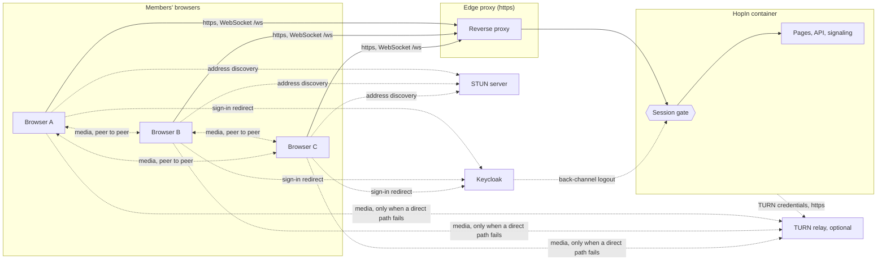
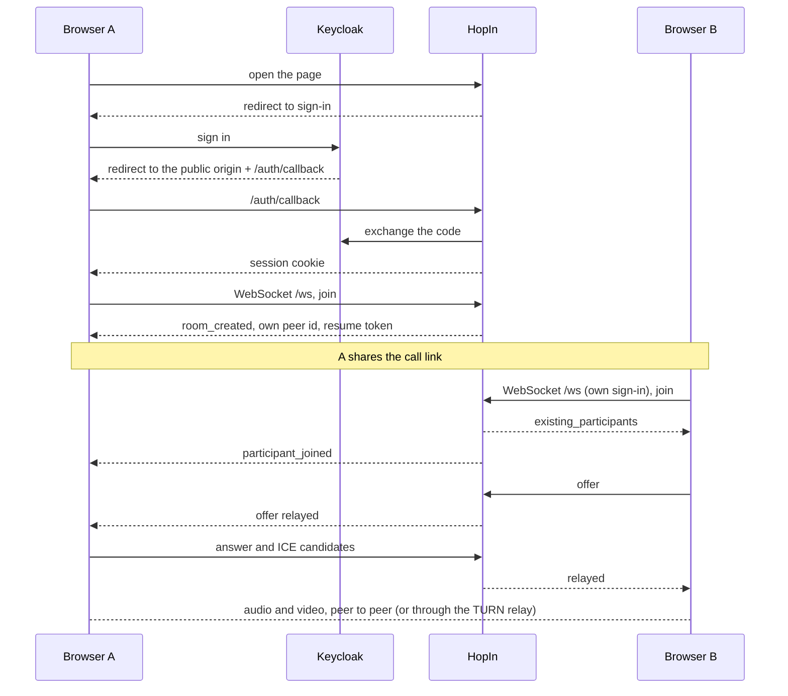

# HopIn Architecture

How HopIn is built, how a call runs and what it trusts. For what HopIn is and how to run it, see the [README](../README.md).

## 1. Context and Scope

A call is a full mesh: every browser sends its media straight to every other browser, or through a TURN relay when the operator has switched it on and a direct path fails. HopIn's server never sees audio or video. It signs people in, hands out call rooms and relays the setup messages (offers, answers, candidates), chat lines and media state between the members of one room; it keeps recent frames in replay logs for a resume.

The session gate sits in front of every route and `/ws`; only the paths in `PUBLIC_PATHS` (`src/hopin/auth/gate.py`) and Keycloak's back-channel logout POST pass without a session. HopIn depends on Keycloak as an external service (the authorisation, token, JWKS and logout endpoints under the configured issuer, built in `auth/sign_in.py`); the ICE servers are a STUN server and, when `HOPIN_TURN_PROVIDER` is not `off`, a TURN relay (an external service; only `web/turn_relay.py` and the configuration name its provider). Media goes peer to peer unless a direct path fails; it then flows through the relay, still encrypted end to end between the browsers.

## 2. Building Block View

Server packages under `src/hopin/`, each with one job. Their dependency order is the `layers` contract in `pyproject.toml` (`[tool.importlinter]`).

| Package | Job |
|---|---|
| `config` | settings from the environment, application constants, enums, the shared secret-file reader and `StartRefusedError` |
| `auth` | sign-in against Keycloak through webauth, the session gate, the in-memory stores of accounts and sessions |
| `rooms` | rooms, participants, their capacity and lock |
| `signaling` | the WebSocket: who a socket is, the frames, seats, replay, timers |
| `web` | pages, static files, the health route, the ICE server list and the TURN provider adapter |
| `main` | starts the server |
| `errors` | HopIn's exception types |
| `people.py` | the admin download of what HopIn holds about one person |
| `app.py` | the one place that wires the packages and installs the webauth middleware |

The browser is static ES modules under `src/hopin/web/static/assets/js/` ([ADR 0001](decisions/0001-static-frontend-modules.md)). `app.js` is the only wiring; the other modules group by job:

- **Screens and navigation:** `router`, `home`, `account`, `menus`, `prejoin`, `end`, `dialogs`
- **Connection to the server:** `signaling`, `replay` (frames resent after a resume)
- **Peer connections:** `mesh`, `recovery` (ICE restart), `bandwidth` (upload cap by call size)
- **Local and remote media:** `media`, `media-state`, `speaking`, `quality`
- **The call's surface:** `stage`, `pip`, `controls`, `invite`, `status`, `chat`, `toast`, `sounds`
- **State:** `state`, the one mutable call state, with no DOM

## 3. Runtime View

**Frames.** Messages are JSON over the WebSocket; the signal types are `SignalType` in `src/hopin/config/constants.py` and `signaling/handler.py` handles them. Invariants:

- The server identifies a socket by its webauth session at the handshake and names every peer with an id it mints, so peers address each other only by those ids. A relay reaches only members of the sender's room.
- Every server frame carries a `seq`, and every client frame after a socket's first does too, except `resumed` and `resume_refused`: the server writes them without one and the browser handles them before it filters by `seq`. Each side keeps its last `REPLAY_LOG_LIMIT` frames; a frame at or below the last `seq` received is ignored.
- A frame longer than `MAX_SIGNALING_FRAME_LENGTH` is refused and neither relayed nor kept.
- The resume token is a secret of the seat: it travels only in frames to its owner, changes with every resume and is never logged.

**Room lifecycle.**

- The host is the account that started the call, not a connection. Only the host locks, unlocks and ends the call; a locked room keeps its members and refuses new joins except from the host's account, which can return, subject to capacity.
- A dropped member keeps the seat for `RESUME_WINDOW_SECONDS` and takes it back with the resume token, replaying the frames missed. A refused resume is answered alike for every cause and the page joins afresh.
- When the host's last connection drops, the call waits `HOST_GRACE_SECONDS` for the host to return and then ends for everyone.
- Every `SESSION_RECHECK_SECONDS`, and on every frame, the socket's session is checked again. When it has ended, the server closes the socket with `SESSION_ENDED_CLOSE_CODE`; the page stops the call and signs in again. A back-channel logout ends every session of that person and also removes their HopIn account; the next sign-in creates it again.

## 4. Deployment View

One container, built from `Dockerfile` and run by `compose.yaml` behind the edge reverse proxy, which terminates https. It publishes no host port and answers on a network of its own. All state (accounts, sessions, rooms, seats, replay logs, rate limit counters) lives in process memory, so a restart ends every call and every session; there is no database. The client secret, the session signing key and, when TURN is on, the two TURN key files are read at start from the files the settings name.

## 5. Crosscutting Concepts

**Sign-in and sessions.** webauth runs the OIDC code flow against Keycloak. Admission needs the group `/apps/hopin`; the group `/apps/hopin/admin` (and below) is the admin role. The redirect URI is `HOPIN_PUBLIC_ORIGIN` plus `/auth/callback`, and the host check admits only that origin's host. The session cookie is `Secure` and `SameSite=Lax`.

**Request limits.** Sign-in requests have their own budget (`SIGN_IN_RATE_LIMIT_BUDGET`), every other path another (`DEFAULT_RATE_LIMIT_BUDGET`); `/health` and the back-channel logout are exempt. Request bodies are capped. All in `src/hopin/config/constants.py`.

**Security headers.** webauth's Content-Security-Policy, extended with the issuer's origin for the logout redirect, plus a Permissions-Policy. The reasoning for static, inline-free pages is in [ADR 0001](decisions/0001-static-frontend-modules.md).

**Persistence.** None. What HopIn holds about a person, and what an admin may download, is in the README under A Person's Data.

**Logging.** structlog lines carry peer ids, room ids, event kinds, causes and reasons, close codes and exceptions without local variables; the `account_event` line carries the person's Keycloak id and role. No event has a field for chat text, tokens or secrets, but one field carries what a browser sent: the identity provider's error code from the sign-in callback, which webauth keeps only as a short code-shaped token (`auth/sign_in.py`, `sign_in_refused`). Whatever a client puts into that field reaches the log.

### Trust

The model is HopIn's own; no operator ruling narrows it.

- **A member's browser** reaches pages, the API and `/ws` with a session. It controls everything it sends (chat lines, its media state, connection descriptions) and its own address. HopIn trusts none of it beyond the session: the names others see come from the Keycloak account, the sender of each relayed frame is the server-minted peer id, and host actions are checked against the account. The protections differ by route: HTTP requests are rate-limited (webauth's middleware covers HTTP scopes only); the WebSocket is admitted only with a session and an allowed Origin (`signaling/identity.py`) and each frame is capped at `MAX_SIGNALING_FRAME_LENGTH`; there is no per-frame rate limit.
- **Anyone without a session** reaches only `PUBLIC_PATHS`, the sign-in routes and Keycloak's logout POST. HopIn trusts nothing they send and rate limits them by address.
- **Keycloak** decides who is a member and who is an admin; HopIn trusts its signed tokens from the one configured issuer, and a logout token signed by that issuer to end sessions and remove the person's HopIn account (the next sign-in creates it again). HopIn checks that token, not who sent it, and relies on the proxy in front to keep the back-channel route off the public internet ([edge's README](https://github.com/overnightworks/edge)).
- **The proxy hops** named in `HOPIN_TRUSTED_PROXIES` are trusted to state the person's address in `X-Forwarded-For`, which the rate limits key on. A hop that is wrongly listed lets a person choose their counted address; empty trusts none.
- **The other participants of a call** see each other's addresses (peer-to-peer media reveals them) and receive relayed frames: names, chat lines, media state, connection descriptions. A member is trusted with that much and no more: they cannot address people outside their room, or act as host.
- **The STUN server** learns the address of every browser that asks and can answer wrongly, which at worst prevents a connection; it never carries media. The operator chooses it by `HOPIN_STUN_SERVER`.
- **The TURN provider** (when `HOPIN_TURN_PROVIDER` is not `off`) sees who connects to whom and when, the traffic volume and, when unencrypted, the audio level (#79 finding 26); it sees no media content, which stays encrypted between the browsers. HopIn trusts only its credential answer, and only over https from the provider's fixed endpoint; a failed or malformed answer gives a call STUN only. It bills the operator for relayed traffic.
- **The operator's settings and secret files** are trusted fully: the settings are `HOPIN_` environment variables, but the client secret, the session signing key and the two TURN key files are read at start from the files they name and never enter the environment, and HopIn names only the failing setting when one is wrong.

## 6. Architectural Decisions

[ADR 0001](decisions/0001-static-frontend-modules.md) holds the frontend decision. The import-linter contracts in `pyproject.toml` hold the dependency direction between packages.

## 7. Risks and Technical Debt

- Mesh upload grows with every participant, so a call is capped at `MAX_PARTICIPANTS_PER_ROOM`.
- TURN costs money and stops slowly: the relay is billed per traffic on the operator's provider account, and HopIn sets no cap of its own (the provider's usage alert is the guard). Switching TURN off or stopping HopIn ends new credentials only; a credential already handed out stays valid at the provider for up to 12 hours. With TURN off, calls on networks that block direct paths cannot connect.
- A restart ends every call and session.
