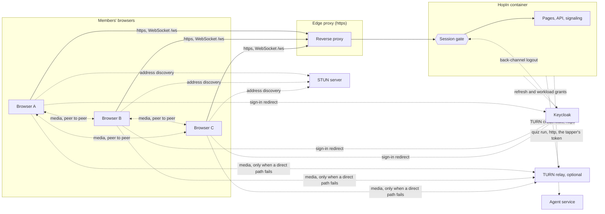
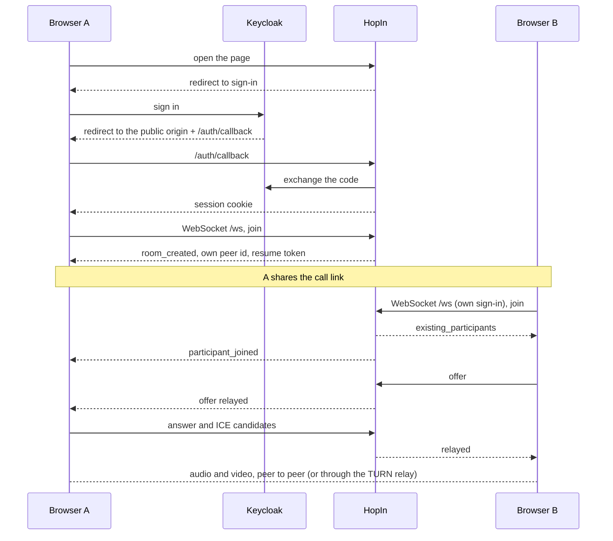

# HopIn Architecture

How HopIn is built, how a call runs and what it trusts. For what HopIn is and how to run it, see the [README](../README.md).

## 1. Context and Scope

A call is a full mesh: every browser sends its media straight to every other browser, or through a TURN relay when the operator has switched it on and a direct path fails. HopIn's server never sees audio or video. It signs people in, hands out call rooms and relays the setup messages (offers, answers, candidates), chat lines and media state between the members of one room; it keeps recent frames in replay logs for a resume. For the game master it asks the fleet's agent service for quiz questions, their answers and a final score, and sends it the given answers with their players' names, on the account of the person who tapped Start quiz.

The session gate sits in front of every route and `/ws`; only the paths in `PUBLIC_PATHS` (`src/hopin/auth/gate.py`) plus the `/_app/` stylesheets the built sign-in pages link, the fonts those stylesheets reference and the sign-in routes' own public rules (`SIGN_IN_PATHS`, `src/hopin/config/constants.py`: start, callback, and the POSTs of logout and Keycloak's back-channel logout) pass without a session. HopIn depends on Keycloak as an external service (the authorisation, token, JWKS and logout endpoints under the configured issuer, built in `auth/sign_in.py`, which also installs the routes webauth serves); the ICE servers are a STUN server and, when `HOPIN_TURN_PROVIDER` is not `off`, a TURN relay (an external service; only `web/turn_relay.py` and the configuration name its provider). Media goes peer to peer unless a direct path fails; it then flows through the relay, still encrypted end to end between the browsers. The agent service is a fleet service on an internal network (`HOPIN_AGENT_SERVICE_URL`); only the game (`game/`) speaks to it, through the `overnightworks-agent-runtime-client` package, and import-linter contracts keep that client and `httpx2` out of every other package.

## 2. Building Block View

Server packages under `src/hopin/`, each with one job. Their dependency order is the `layers` contract in `pyproject.toml` (`[tool.importlinter]`).

| Package | Job |
|---|---|
| `config` | settings from the environment, application constants, enums, the shared secret-file reader and `StartRefusedError` |
| `auth` | sign-in against Keycloak through webauth, the session gate, the in-memory stores of accounts and sessions |
| `rooms` | rooms, participants, their capacity and lock |
| `signaling` | the WebSocket: who a socket is, the frames, seats, replay, timers, and the port for the call's one optional feature (`signaling/features.py`) |
| `game` | the AI game, optional: one quiz per call (its rules in `game/quiz.py`), its runs one at a time, and the agent service adapter (the starter's two tokens and one quiz run over HTTP, turned into a line or a refusal) |
| `web` | the page build and its files, static files, the health route, the ICE server list and the TURN provider adapter |
| `main` | starts the server and switches the game in |
| `errors` | HopIn's exception types |
| `people.py` | the admin download of what HopIn holds about one person |
| `app.py` | the one place that wires the packages and installs the webauth middleware; it names no game |

The game plugs into signaling through one port: the handler offers it every frame type the call core does not know (`ForeignFrame`), tells it when a seat joined a room, when a seat has left its room for good (`seat_left`, with the room and the name the call showed, first used by the quiz) and when a room ended, and shuts it down with the server; through `CallRooms` it reads the rooms and the name the call shows for a seat (`name_of`, first used by the quiz's answers), whether a seat's account hosts its call (`is_host`, first used by End quiz) and sends to seats like the core does. `create_app` takes it as `call_feature` and builds it on the app's own sign-in and scheduler; `main.py` passes it in on its two lines marked `# game`, and `create_app` builds the server without it when `call_feature` is left out. The page starts with or without the game: each feature is bundled under `frontend/src/lib/features/<name>/`, and `GET /api/call-features` (`web/call_features.py`, gated and `no-cache`) names the wired one. `app.js` hands the bundle's `import.meta.glob` of those entries to `loadFeatures` (`lib/call/features.ts`), which imports each named feature and awaits its `install` before signaling connects, because signaling drops for good a frame no handler takes. The features load once, at the first call start, never at page load. `install` gets `FeatureCore` (`lib/call/feature-port.ts`, with `FeatureModule`), the call core's few slots: a frame handler, sending a frame and asking whether the socket is connected, a toast, an item in More, a chat line no person wrote or a line pinned last, a card between the chat's header and its lines (`showChatCard`, first used by the quiz's question card), and a hook for the call's end. The three chat slots take a feature view, a component bound to its props that a feature builds with core chat's `featureView`; core renders it and never names what it shows. Besides `featureView`, the module imports only the generated wires (the core's `lib/wire.ts` and its own `wire.ts`) and the core's types. A feature that fails to load, its stylesheet included, never stops the call: `loadFeatures` resolves to `false`, the page starts without it and shows one generic toast. The import contract `call-core-knows-no-game` keeps the call core from reaching the game, and its eslint twin in `frontend/eslint.config.js` keeps the frontend's core code from importing `features/game`. Removing the game is `scripts/remove_game.py`'s deletion (the game's packages, its frontend directory and tests, the lines marked `# game` in `main.py`, `tests/conftest.py` and the wire generator, and the agent-service client and the runtime dependency httpx2, which stays in the dev group as Starlette's TestClient needs it) plus the compose network and the paragraphs of these documents that describe it; the CI job `Removal drill`, a mandatory job of the quality gate, runs that deletion on a copy, builds the frontend there and proves the call's unit tests and a call end to end still pass.

The page is a SvelteKit shell that `make frontend` builds into `src/hopin/web/build/` (never committed; [ADR 0003](decisions/0003-page-layer-on-sveltekit.md)). `PageBuild` (`web/page_build.py`) loads it at start and the server refuses to start without it. `/` and `/c/{room}` answer the shell, `/_app` serves the build's files, and the `(call)` layout carries the page's markup and imports `app.js` after it mounted. The legacy code is only the composition root `frontend/src/lib/legacy/app.js`, bundled with the shell and reached only through that import ([ADR 0001](decisions/0001-static-frontend-modules.md)); the game's module with its stylesheet lives under `frontend/src/lib/features/game/`. `app.js` is the only wiring.

The call's ported logic is TypeScript under `frontend/src/lib/call/`: `signaling` (the one WebSocket, its reconnect and resume), `features` (the feature loader: the names the server offers, each imported from the bundle and installed), `feature-port` (`FeatureCore`, what a feature's `install` is given, and `FeatureModule`), `mesh` (the peer connections and their signaling), `media` (the own camera, microphone and screen share, with their requests and their end), `media-state` (the own audio and video state announced to the others and the others' state handed to the stage), `replay` (the log of sent frames, resent after a resume), `recovery` (ICE restart), `bandwidth` (upload cap by call size), `sounds`, `speaking`, `quality` (the speaking ring and the connection-quality bars, each polled until the peer's connection closes and reported through the port), `state` (the one mutable call state, with no DOM) and `stage-port`, the seam through which the call code reaches the stage: the page installs the `stage` module (below) into it at start-up, and `mesh`, `media` and `media-state`, and the pre-join's `prejoin`, call the stage through its forwarders instead of importing it, and the port owns the connection-quality words they exchange. The page's ported interface helpers are TypeScript under `frontend/src/lib/ui/` (`menus`: open, close and focus of the page's popover menus, which the layout registers for the call bar's More and Invite and for the account menu; `controls`: the call bar's device buttons, the lock switch and their clicks, rendered by the layout, and the leave callback `legacy/app.js` installs; `toast`: the one current toast, rendered by `Toasts.svelte`; `leave-dialog`: the leave confirmation's open state in a Svelte runes module, whose confirm action `legacy/app.js` installs at start-up for the same reason: ported code never imports legacy; `status`: the call's status line, lock tag and participant count, rendered by the layout from `.svelte.ts` state; `account`: the person's name and initials read from `/api/account` (sign-in again on 401), rendered by the layout into the triggers and appkit's `AccountMenu` inside hopin's dialog, which `menus` registers; `navigation`: the room id and call link of the address, the document loads home, into a call and through sign-in, and the shallow rewrite of the address to the call link; `screens`: the current screen, which the layout shows by the `hidden` class of the four `<main data-screen>` tags; `home`: the greeting and the start request, whose callback `legacy/app.js` installs because ported code never imports legacy; `prejoin`: the pre-join screen's texts, device choices and media request, rendered by the layout; the start callback `legacy/app.js` installs; `invite`: the call link, the waiting card, copy and share; `chat`: the panel's open state, unread count, draft and lines, rendered by the layout, where a feature's lines, pinned bubble and card are feature views (`featureView`: a component bound to its props), rendered inside `display: contents` wrappers; `end`: the end screen's kinds, their texts and actions, and the shown end; and `stage`: the whole stage port, the own picture of the call tile and the pre-join preview and the remote tiles, which `Tiles.svelte` renders; the videos take their streams and the quality bars their reports through the `stage-media` actions, and the tiles' streams stay in plain maps outside the reactive state; `pip`: the own tile's picture-in-picture drag on a phone call of two, attached by the layout). Vitest judges both at 100 % branch (`pnpm test:coverage`), and `legacy/app.js` imports them, never the reverse. `legacy/app.js` and the `.svelte` files are reached only by the end-to-end suite: CI collects Chromium's V8 coverage of every page it opens (`tests/e2e/support/browser_coverage.py`), maps it through the build's hidden source maps and uploads it as the `browser-coverage` lcov artifact of the `End-to-end` job. That report is not judged: no threshold applies to it, and the image and the package carry no source map.

## 3. Runtime View

**Frames.** Messages are JSON over the WebSocket; the signal types are `SignalType` in `src/hopin/config/constants.py` and the game's `GameSignal` in `src/hopin/game/vocabulary.py`, whose generated `wire.ts` sits beside the game's module; `signaling/handler.py` decodes and dispatches them, `signaling/routing.py` owns rooms, host grace and fan-out, and `signaling/seats.py` owns seats, delivery, parking, resume and replay. The call core takes these tokens from the generated `frontend/src/lib/wire.ts`; the game reads its own generated `frontend/src/lib/features/game/wire.ts` (`scripts/generate_wire.py` writes both from the Python owners; ADR 0002, which served them, is superseded). Invariants:

- The server identifies a socket by its webauth session at the handshake and names every peer with an id it mints, so peers address each other only by those ids. A relay reaches only members of the sender's room.
- Every server frame carries a `seq`, and every client frame after a socket's first does too, except `resumed` and the seat-less error frames (`resume_refused`, `too_many_calls`): the server writes them without one, and a frame without `seq` passes the browser's filter. Each side keeps its last `REPLAY_LOG_LIMIT` frames; a frame at or below the last `seq` received is ignored.
- A frame longer than `MAX_SIGNALING_FRAME_LENGTH` is refused and neither relayed nor kept.
- The resume token is a secret of the seat: it travels only in frames to its owner, changes with every resume and is never logged.

**Room lifecycle.**

- The host is the account that started the call, not a connection. Only the host locks, unlocks and ends the call; a locked room keeps its members and refuses new joins except from the host's account, which can return, subject to capacity.
- A dropped member keeps the seat for `RESUME_WINDOW_SECONDS` and takes it back with the resume token, replaying the frames missed, unless the account is at its call cap, which counts the old connection while it is still open; then the page ends the call. Any other refused resume is answered alike for every cause and the page joins afresh.
- When the host's last connection drops, the call waits `HOST_GRACE_SECONDS` for the host to return and then ends for everyone.
- A call has at most one quiz and one game master run. `game/table.py` sends every seat `game_phase` thinking, the question as `game_line` with its round, and answering with the round, the rounds and the starter; each player's `game_answer` (text; a blank or non-string text is an `invalid_message` error) replaces that player's earlier answer and sends every seat `game_answer_count` (`answered` of `players`, counted over the players still in the room, a parked seat inside its grace included); the players are the seats the question's line was delivered to, so a seat that joins during answering plays from the next question, and an answer from anyone else or after the reveal began is refused to its sender as `answer_closed`, one longer than `GAME_ANSWER_MAX_CHARACTERS` after stripping as `answer_too_long`; the reveal request carries each given answer with its player's name as one JSON line, and a player without an answer is not listed; answers live only in the room's quiz in memory and no seat is ever sent another's. When everyone present has answered, no run is in flight and the starter is in the room, the reveal runs on its own, exactly as the starter's `game_reveal` does it: thinking, the answer as `game_line`, then, with no idle in between, a run for the next question with its own thinking, or after the last of `QUIZ_ROUNDS` rounds a run for the final score as `game_line`, then idle. A quiz makes eleven runs at most (the opening question and two per round). A run is not chained for a starter whose seat is gone; that seat's `seat_left` notice ends the quiz. A refusal goes as `game_refused` to its sender alone: a start during a run as `already_answering`, a start during a quiz as `quiz_running`, a reveal from anyone but the starter as `not_starter`. A refused or expired run ends the quiz: its reason goes to the starter and idle to every seat; after the opening question, every seat but the starter also gets `game_ended` before idle. `game_end` from the starter or a host is accepted in any phase: it cancels the quiz's runs (a run waiting for its predecessor never asks, and the room keeps a cancelled run until its call has closed, so a new quiz's first run never overlaps it), and every seat gets `game_ended`, then idle; from anyone else it is refused to its sender as `not_starter_or_host`, and with no quiz it is ignored. The starter's final leave (a leave, an ended session, a grace past `RESUME_WINDOW_SECONDS` or an unresumable seat released) ends the quiz in any phase like `game_end`, and every remaining seat gets `game_ended` with `leaver` (the name the call showed), then idle; an ending already under way wins, and the leave then sends nothing. A player's final leave during answering re-sends the count once the question has an answer, replacing any count still in flight, and runs the reveal when every remaining player has answered; the player's given answer stays for the reveal. A seat that joins during answering is told answering without the question. A run ends at its line, after `GAME_RUN_DEADLINE_SECONDS`, when the call ends (no game frame follows `room_closed`) or when the server stops, which cancels the run and waits until its connection has closed.
- Every `SESSION_RECHECK_SECONDS`, and on every frame, the socket's session is checked again. When it has ended, the server closes the socket with `SESSION_ENDED_CLOSE_CODE`; the page stops the call and signs in again. A back-channel logout ends every session of that person and also removes their HopIn account; the next sign-in creates it again.

## 4. Deployment View

One container, built from `Dockerfile` and run by `compose.yaml` behind the edge reverse proxy, which terminates https. It publishes no host port and answers on a network of its own; it also sits on the back-channel network, which only Keycloak reaches, and on the agent network, where it reaches the agent service. All state (accounts, sessions, rooms, seats, replay logs, rate limit counters) lives in process memory, so a restart ends every call and every session; there is no database. The client secret, the session signing key and, when TURN is on, the two TURN key files are read at start from the files the settings name.

## 5. Crosscutting Concepts

**Sign-in and sessions.** webauth runs the OIDC code flow against Keycloak and serves the start, callback, logout and back-channel logout routes; HopIn defines none of them, only the `/login` and `/no-access` pages and what a refused sign-in shows, and `/account`, which sends a signed-in person to the issuer's account console; `/login`, `/no-access` and the refused sign-in page come from the build. Each sign-in, logout and back-channel entry runs in one in-memory transaction under one lock, holding the guard that every access to the accounts and sessions shares from start to end, so no other request sees or changes them meanwhile, and restores them when it fails, so a back-channel logout that fails answers 400 and ends no session. Admission needs the group `/apps/hopin`; the group `/apps/hopin/admin` (and below) is the admin role. The redirect URI is `HOPIN_PUBLIC_ORIGIN` plus `/auth/callback`, and the host check admits only that origin's host. The session cookie is `Secure` and `SameSite=Lax`, and it is the only cookie HopIn sets once sign-in has finished.

**Request limits.** Sign-in requests have their own budget (`SIGN_IN_RATE_LIMIT_BUDGET`), every other path another (`DEFAULT_RATE_LIMIT_BUDGET`); `/health` and the back-channel logout are exempt. Request bodies are capped. A state-changing request is checked by its origin alone: webauth passes one marked `Sec-Fetch-Site: same-origin`, or one whose fetch site is absent or `same-site` and whose `Origin` names HopIn's host over https, on any port when `HOPIN_PUBLIC_ORIGIN` names none and on exactly that port when it names one; it refuses `cross-site`, any other fetch-site value, and a request with neither header, whatever its content type. Only Keycloak's back-channel logout is exempt: webauth derives that path, the sign-in budget's paths (logout included), the back-channel body bound (32 KiB) and the `no-store` rule from the one `SIGN_IN_PATHS` in `src/hopin/config/constants.py`, and `src/hopin/app.py` installs them. There is no CSRF token or cookie.

**Security headers.** webauth's Content-Security-Policy plus a Permissions-Policy. The policy admits the shell's inline scripts by hash (read from the built shell at start, never `'unsafe-inline'`) and, in `style-src`, exactly the hash of the one style SvelteKit's route announcer writes; every other inline style stays refused. The build's `immutable/` files are cached `private, max-age=31536000, immutable` by the `/_app` mount itself on its successful answers only, because the files are behind the session gate, except the built sign-in pages' stylesheets and the fonts those stylesheets reference, which are served the same line to anyone; every other `/_app` file is `no-cache`. The logout answer is webauth's own page under its own policy, which admits the issuer's origin for that one form. The reasoning is in [ADR 0001](decisions/0001-static-frontend-modules.md) and [ADR 0003](decisions/0003-page-layer-on-sveltekit.md).

**Persistence.** None. What HopIn holds about a person, and what an admin may download, is in the README under A Person's Data.

**Logging.** structlog lines carry peer ids, room ids, event kinds, causes and reasons, close codes, the call cap and exceptions without local variables; the `account_event` line carries the person's Keycloak id and role. No event has a field for chat text, a quiz answer, tokens or secrets, but one field carries what a browser sent: the identity provider's error code from the sign-in callback, which webauth keeps only as a short code-shaped token (`auth/sign_in.py`, `sign_in_refused`). Whatever a client puts into that field reaches the log. The game master logs only codes: `game_master_run` (room id, outcome, `ended` for a run an End or the starter's leave cancelled, duration in milliseconds), `agent_service_refused` (HTTP status, rejection or failure code, stream violation kind, `oversized` for a rejection past `GAME_REJECTION_MAX_BYTES`, or error type), `game_master_token_refused` (which token, webauth's and the issuer's refusal reason, the issuer's error code when it is one of OAuth's token endpoint codes, else `other`) and, for a defect, `game_master_raised` and `game_driver_failed` (the exception type, also for a seat whose write broke while the others got the run's frames); no field carries a prompt, a question, a token or what the agent service answered, and the HTTP client's own loggers (`httpx2`, `httpcore2`) are silenced, since they would log the answer's status line, headers and errors.

### Trust

The model is HopIn's own; no operator ruling narrows it.

- **A member's browser** reaches pages, the API and `/ws` with a session. It controls everything it sends (chat lines, its media state, connection descriptions) and its own address. HopIn trusts none of it beyond the session: the names others see come from the Keycloak account, the sender of each relayed frame is the server-minted peer id, and host actions are checked against the account. The protections differ by route: HTTP requests are rate-limited (webauth's middleware covers HTTP scopes only) and a state-changing one needs same-origin provenance (`Sec-Fetch-Site: same-origin`, or an `Origin` of HopIn's host over https, on any port when `HOPIN_PUBLIC_ORIGIN` names none and on exactly that port when it names one, when the fetch site is absent or `same-site`; see Request limits); the WebSocket is admitted only with a session and an allowed Origin (`signaling/identity.py`) and each frame is capped at `MAX_SIGNALING_FRAME_LENGTH`; there is no per-frame rate limit. One account holds at most `MAX_LIVE_SEATS_PER_ACCOUNT` live sockets, counted in `Seats` at the handshake, because webauth's rate limit does not cover `/ws`.
- **Anyone without a session** reaches only `PUBLIC_PATHS`, the built sign-in pages' stylesheets and the fonts those stylesheets reference, the sign-in routes and Keycloak's logout POST. HopIn trusts nothing they send and rate limits them by address.
- **Keycloak** decides who is a member and who is an admin; HopIn trusts its signed tokens from the one configured issuer, and a logout token signed by that issuer to end sessions and remove the person's HopIn account (the next sign-in creates it again). HopIn checks that token, not who sent it, and relies on the proxy in front to keep the back-channel route off the public internet ([edge's README](https://github.com/overnightworks/edge)). The session store holds each login's ID token and refresh token, both secrets: they stay in the session row, which ends with the session, and the ID token leaves the server only once, in the no-store logout page whose form the person's own browser posts to Keycloak as the hint. The refresh token is spent once per game master run, for the tapper's access token, and its rotated successor replaces it in the row; a second grant gives HopIn its own workload token.
- **The proxy hops** named in `HOPIN_TRUSTED_PROXIES` are trusted to state the person's address in `X-Forwarded-For`, which the rate limits key on. A hop that is wrongly listed lets a person choose their counted address; empty trusts none.
- **The other participants of a call** see each other's addresses (peer-to-peer media reveals them) and receive relayed frames: names, chat lines, media state, connection descriptions. A member is trusted with that much and no more: they cannot address people outside their room, or act as host.
- **The STUN server** learns the address of every browser that asks and can answer wrongly, which at worst prevents a connection; it never carries media. The operator chooses it by `HOPIN_STUN_SERVER`.
- **The TURN provider** (when `HOPIN_TURN_PROVIDER` is not `off`) sees who connects to whom and when, the traffic volume and, when unencrypted, the audio level (#79 finding 26); it sees no media content, which stays encrypted between the browsers. HopIn trusts only its credential answer, and only over https from the provider's fixed endpoint; a failed or malformed answer gives a call STUN only. It bills the operator for relayed traffic.
- **The agent service** receives, per run, the tapper's access token (which carries the tapper's own account and name), HopIn's workload token, the quiz prompt and this quiz's turns so far, which from the first reveal on hold each given answer with its player's name; it decides whether the tapper's account may use AI. HopIn trusts it for no more than one line per run: the answer is cut to `GAME_LINE_MAX_CHARACTERS`, shown as text, never as markup, and anything other than a well-formed answer turns into a refusal for the tapper alone. HopIn reaches it over plain HTTP on the internal agent network, follows no redirect and keeps nothing it says beyond the quiz. A member controls their answer's text, and HopIn sends it as JSON data that the prompt says never to follow; a member who still steers the game master's line reaches only their own call, as plain text marked AI and cut at 600 characters, which is no more than a chat line reaches. The quiz agent has no tools, and its runs carry nothing beyond this quiz.
- **The operator's settings and secret files** are trusted fully: the settings are `HOPIN_` environment variables, but the client secret, the session signing key and the two TURN key files are read at start from the files they name and never enter the environment, and HopIn names only the failing setting when one is wrong.

## 6. Architectural Decisions

[ADR 0001](decisions/0001-static-frontend-modules.md) and [ADR 0003](decisions/0003-page-layer-on-sveltekit.md) hold the frontend decisions. The import-linter contracts in `pyproject.toml` hold the dependency direction between packages.

## 7. Risks and Technical Debt

- Mesh upload grows with every participant, so a call is capped at `MAX_PARTICIPANTS_PER_ROOM`.
- TURN costs money and stops slowly: the relay is billed per traffic on the operator's provider account, and HopIn sets no cap of its own (the provider's usage alert is the guard). Switching TURN off or stopping HopIn ends new credentials only; a credential already handed out stays valid at the provider for up to 12 hours. With TURN off, calls on networks that block direct paths cannot connect.
- A restart ends every call and session.
