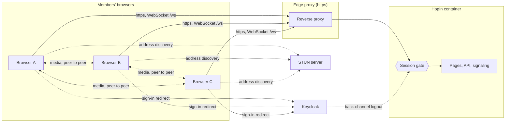
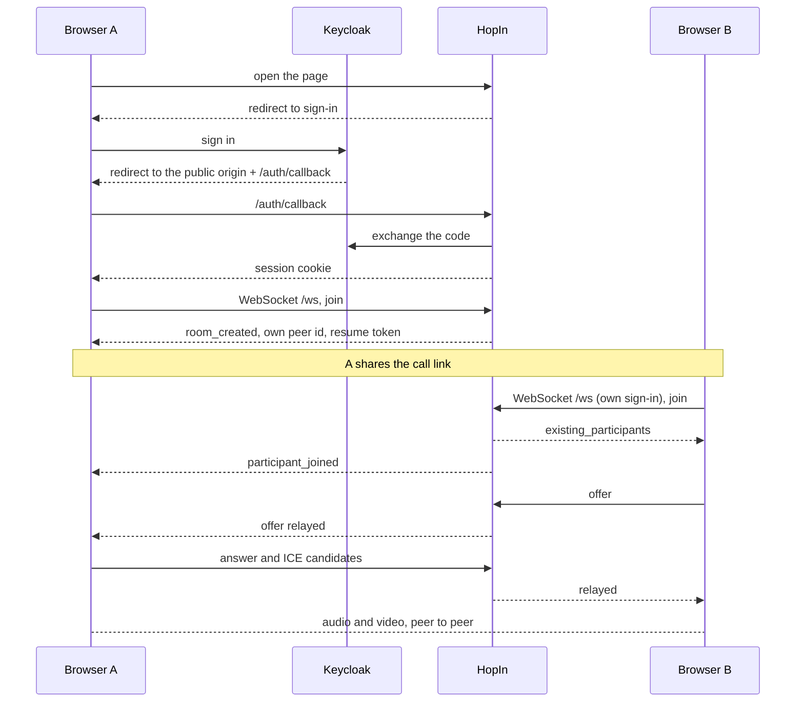

# HopIn Architecture

How HopIn is built, how a call runs and what it trusts. For what HopIn is and how to run it, see the [README](../README.md).

## 1. Context and Scope

A call is a full mesh: every browser sends its media straight to every other browser. HopIn's server never sees audio or video. It signs people in, hands out call rooms and relays the setup messages (offers, answers, candidates) between the members of one room.

The session gate sits in front of every route and `/ws`; only the paths in `PUBLIC_PATHS` (`src/hopin/auth/gate.py`) and Keycloak's back-channel logout POST pass without a session. Today the only server beyond HopIn's own is a STUN server; media always goes peer to peer.

## 2. Building Block View

Server packages under `src/hopin/`, each with one job. Their dependency order is the `layers` contract in `pyproject.toml` (`[tool.importlinter]`).

| Package | Job |
|---|---|
| `config` | settings from the environment, application constants, enums |
| `auth` | sign-in against Keycloak through webauth, the session gate, the in-memory stores of accounts and sessions |
| `rooms` | rooms, participants, their capacity and lock |
| `signaling` | the WebSocket: who a socket is, the frames, seats, replay, timers |
| `web` | pages, static files, the health route and the ICE server list |
| `people.py` | the admin download of what HopIn holds about one person |
| `app.py` | the one place that wires the packages and installs the webauth middleware |

The browser is static ES modules under `src/hopin/web/static/assets/js/` ([ADR 0001](decisions/0001-static-frontend-modules.md)). `app.js` is the only wiring; the other modules group by job:

- **Screens and navigation:** `router`, `home`, `account`, `menus`, `prejoin`, `end`, `dialogs`
- **Connection to the server:** `signaling`, `replay` (frames resent after a resume)
- **Peer connections:** `mesh`, `recovery` (ICE restart), `bandwidth` (upload cap by call size)
- **Local and remote media:** `media`, `media-state`, `speaking`, `quality`
- **The call's surface:** `stage`, `pip`, `controls`, `invite`, `status`, `chat`, `toast`, `sounds`
- **State:** `state`, the one mutable call state, with no DOM

## 3. Runtime View

**Frames.** Messages are JSON over the WebSocket; the signal types are `SignalType` in `src/hopin/config/constants.py` and `signaling/handler.py` handles them. Invariants:

- The server identifies a socket by its webauth session at the handshake and names every peer with an id it mints, so peers address each other only by those ids. A relay reaches only members of the sender's room.
- Every server frame carries a `seq`, and every client frame after a socket's first does too. Each side keeps its last `REPLAY_LOG_LIMIT` frames; a frame at or below the last `seq` received is ignored.
- A frame longer than `MAX_SIGNALING_FRAME_LENGTH` is refused and neither relayed nor kept.
- The resume token is a secret of the seat: it travels only in frames to its owner, changes with every resume and is never logged.

**Room lifecycle.**

- The host is the account that started the call, not a connection. Only the host locks, unlocks and ends the call; a locked room refuses new joins and keeps its members.
- A dropped member keeps the seat for `RESUME_WINDOW_SECONDS` and takes it back with the resume token, replaying the frames missed. A refused resume is answered alike for every cause and the page joins afresh.
- When the host's last connection drops, the call waits `HOST_GRACE_SECONDS` for the host to return and then ends for everyone.
- Every `SESSION_RECHECK_SECONDS`, and on every frame, the socket's session is checked again. When it has ended, the server closes the socket with `SESSION_ENDED_CLOSE_CODE`; the page stops the call and signs in again. A back-channel logout ends every session of that person.

## 4. Deployment View

One container, built from `Dockerfile` and run by `compose.yaml` behind the edge reverse proxy, which terminates https. It publishes no host port and answers on a network of its own. All state (accounts, sessions, rooms, seats, replay logs, rate limit counters) lives in process memory, so a restart ends every call and every session; there is no database.

## 5. Crosscutting Concepts

**Sign-in and sessions.** webauth runs the OIDC code flow against Keycloak. Admission needs the group `/apps/hopin`; the group `/apps/hopin/admin` (and below) is the admin role. The redirect URI is `HOPIN_PUBLIC_ORIGIN` plus `/auth/callback`, and the host check admits only that origin's host. The session cookie is `Secure` and `SameSite=Lax`.

**Request limits.** Sign-in requests have their own budget (`SIGN_IN_RATE_LIMIT_BUDGET`), every other path another (`DEFAULT_RATE_LIMIT_BUDGET`); `/health` and the back-channel logout are exempt. Request bodies are capped. All in `src/hopin/config/constants.py`.

**Security headers.** webauth's Content-Security-Policy, extended with the issuer's origin for the logout redirect, plus a Permissions-Policy. The reasoning for static, inline-free pages is in [ADR 0001](decisions/0001-static-frontend-modules.md).

**Persistence.** None. What HopIn holds about a person, and what an admin may download, is in the README under A Person's Data.

**Logging.** structlog lines carry peer ids, room ids and event kinds. Secrets, tokens and message contents are never logged; the `account_event` line carries the person's Keycloak id.

### Trust

The model is HopIn's own; no operator ruling narrows it.

- **A member's browser** reaches pages, the API and `/ws` with a session. It controls everything it sends: frames, names it claims in chat and media state, its own address. HopIn trusts none of it beyond the session: the server mints peer ids, checks host actions against the account, caps frame length and applies the rate limits.
- **Anyone without a session** reaches only `PUBLIC_PATHS`, the sign-in routes and Keycloak's logout POST. HopIn trusts nothing they send and rate limits them by address.
- **Keycloak** decides who is a member and who is an admin; HopIn trusts its signed tokens from the one configured issuer, and a signed logout token to end sessions. The back-channel route should stay off the public internet.
- **The proxy hops** named in `HOPIN_TRUSTED_PROXIES` are trusted to state the person's address in `X-Forwarded-For`, which the rate limits key on. A hop that is wrongly listed lets a person choose their counted address; empty trusts none.
- **The other participants of a call** see each other's addresses (peer-to-peer media reveals them) and receive relayed frames: names, chat lines, media state, connection descriptions. A member is trusted with that much and no more: they cannot address people outside their room, or act as host.
- **The STUN server** learns the address of every browser that asks and can answer wrongly, which at worst prevents a connection; it never carries media. The operator chooses it by `HOPIN_STUN_SERVER`.
- **The operator's settings and secret files** are trusted fully: they hold the client secret and the session signing key, are read at start from files and never enter the environment, and HopIn names only the failing setting when one is wrong.

## 6. Architectural Decisions

[ADR 0001](decisions/0001-static-frontend-modules.md) holds the frontend decision. The import-linter contracts in `pyproject.toml` hold the dependency direction between packages.

## 7. Risks and Technical Debt

- Mesh upload grows with every participant, so a call is capped at `MAX_PARTICIPANTS_PER_ROOM`.
- STUN only: on networks that block direct paths a call cannot connect. TURN is #25 row 7.
- A restart ends every call and session.
