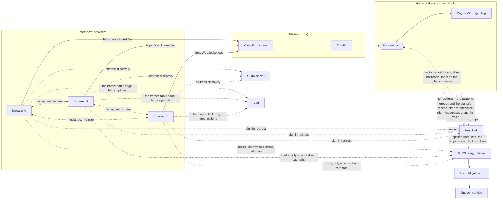
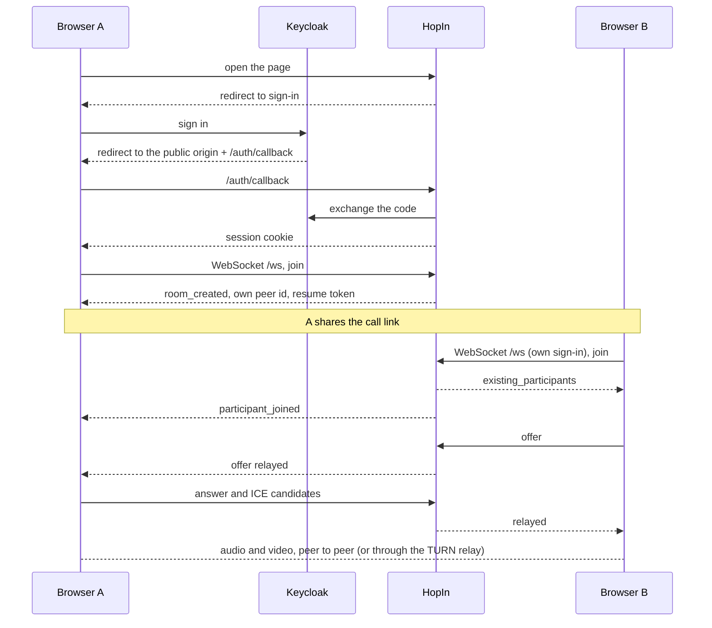

# HopIn Architecture

How HopIn is built, how a call runs and what it trusts. For what HopIn is and how to run it, see the [README](../README.md).

## 1. Context and Scope

A call is a full mesh: every browser sends its media straight to every other browser, or through a TURN relay when the operator has switched it on and a direct path fails. HopIn's server never sees call audio or video; it fetches the game master's spoken lines from the speech service. It signs people in, hands out call rooms and relays the setup messages (offers, answers, candidates), chat lines and media state between the members of one room; it keeps recent frames in replay logs for a resume. For the game master it asks the fleet's LiteLLM gateway for quiz questions, their answers and a final score, and sends it the given answers with their players' names, for the person who tapped Quiz starten.

The session gate sits in front of every route and `/ws`; only the paths in `PUBLIC_PATHS` (`src/hopin/auth/gate.py`) plus the `/_app/` stylesheets the built sign-in pages link, the fonts those stylesheets reference and the sign-in routes' own public rules (`SIGN_IN_PATHS`, `src/hopin/config/web_policy.py`: start, callback, and the POSTs of logout and Keycloak's back-channel logout) pass without a session. HopIn depends on Keycloak as an external service (the authorisation, token, JWKS and logout endpoints under the configured issuer, built in `auth/sign_in.py`, which also installs the routes webauth serves); the ICE servers are a STUN server and, when `HOPIN_TURN_PROVIDER` is not `off`, a TURN relay (an external service; only `web/turn_relay.py` and the configuration name its provider). Media goes peer to peer unless a direct path fails; it then flows through the relay, still encrypted end to end between the browsers. The LiteLLM gateway is a fleet service on an internal network (`HOPIN_AGENT__GATEWAY__ORIGIN`); only the game's connector (`agent/`) speaks to it, through the `overnightworks-agents` package's `GatewayBackend`, import-linter contracts keep that client and `httpx2` out of the call core, and the speech service is likewise the connector's alone (the settings in `agent/speech_settings.py`, which stay with the game removed, and the game's voice in `agent/speech.py`, through the `overnightworks-speech-client` package's bounded `speak` call), kept out of the call core and of `main` and `app` by contracts; `tests/game/test_quiz_agent_connector_imports.py` holds the rest for the agents client (only `agent/backend.py` names it beyond its `config`, only `agent/settings.py` names `config`, and no other module names it or `httpx2`) and `tests/agent/test_speech_imports.py` for the speech client (only `agent/speech.py` and `agent/speech_settings.py` name it).

## 2. Building Block View

Server packages under `src/hopin/`, each with one job. Their dependency order is the `layers` contract in `pyproject.toml` (`[tool.importlinter]`).

| Package | Job |
|---|---|
| `config` | settings from the environment, application constants, enums, the shared secret-file reader and `StartRefusedError` |
| `auth` | sign-in against Keycloak through webauth, the session gate, webauth's single-process stores of accounts and sessions (`create_app` builds them with the logging audit sink of `auth/sign_in.py`) |
| `rooms` | rooms, participants, the places people and joined agents share, and the lock |
| `signaling` | the WebSocket: who a socket is, the frames, seats, replay, timers, and the port for the call's optional features (`signaling/features.py`) |
| `game` | the AI game, optional: one quiz per call (its rules in `game/quiz.py`), its runs one at a time |
| `skat` | the Skat table a call shows, optional and with no game in it: one attached table per call (`skat/stage.py`), who may attach and remove it, and the frames (`skat/feature.py`); the setting and the table address are `skat/settings.py` |
| `participation` | who besides the seats' people is in a call, optional and with no AI in it: the agents a person dials in (`participation/feature.py`: presence, bounds, the frames), whichever seat sponsors them, each taking a place of the call that `rooms` counts with its people, and 32 in the process, of both kinds; an agent with an account of its own is live while it calls, on a lease of the connector's `LEASE_SECONDS` that each admitted call renews and whose expiry, or a change of owner, ends its places and signals its standing (`participation/live_agents.py`). Its places (`participation/places.py`) are an open invitation, bound to the owner's exact seat with an epoch that every removal or withdrawal raises and that its expiry or decline leaves as it is, or a joined tile that holds the agent's chat window (`participation/chat_window.py`: the newest 100 lines within 256 KiB of text, numbered within the join's generation, plain Python that names no agent runtime; `agent/mcp.py` maps it to the library's window and lists and reads it as the resource of the call's place for the principal whose agent it is); a seat's park, resume or departure signals the agents it sponsors through the call core's `seat_changed`. What a joined agent says aloud is queued per agent in `participation/speaking.py` and kept as a sound in `participation/voice.py` until it has played (CALL-60). Who may hear a seat is its sponsor's switch for a joined agent (`participation/hearing.py`), told to a port that the connector fills with the library's `MemberHearing` (`agent/hearing.py`); every end of an agent, a seat or a call reaches the record at once, and a heard sentence joins the window of each agent the record names. A member of the adders group (`HOPIN_AGENT_ADDERS`, `participation/settings.py`: an owner's subject to a full group path, compared exactly) is offered the owner's live agent in More while the owner's one seat is in the call, and the call's host and each such member are shown that control even with no agent listed (the `agent_offers` frame carries `shown`); the add reads the adder's groups fresh and opens the invitation, and `accept_invitation` turns it into the tile, while `decline_invitation` ends it with the outcome busy. An agent's figure (`participation/figures.py`, pure apart from its transport port) is kept on the joined place only when its URL lies under a prefix of `HOPIN_FIGURE_SOURCES`, else the tile keeps its symbol and a closed code is logged; `agent_joined` then carries the route's path for its digest, which the page's `figure` module draws on the tile (see Trust). The route `GET /api/participation/figures/{sha256}` serves any signed-in member the file of a digest a joined agent names: fetched on the first read through `participation/figure_transport.py` (one streamed GET over urllib3, which follows no redirect itself and ends the connection when the time left runs out), one fetch per digest at a time on two workers of its own, within one deadline and a byte bound, checked against the digest and the glTF binary header, and kept in memory least recently used within a byte bound |
| `agent` | the agent connector, optional and in a layer above the game and participation: `agent/mcp.py` (the MCP person front, its protected resource and participation composed for `main`; it reads the kind of agent from the admitted request, serves an agent with an own account its standing as the resource `member://standing` and signals it on every change of a place, over revision 2026-07-28 only, with the front running inside the app's lifespan; every admitted call of an own account, the opening of a listen included, renews its lease) and `agent/tools.py` (`join_call`, `accept_invitation` and `decline_invitation` in the runtime's shared shape, `leave_call`, `say` and `speak`, which the quiz agent never gets, and the one table of which tool serves which kind of agent); `agent/speaking.py` (the speech client's `speak` rendered to a WAV on HopIn's workload token and a person's token, which the game's voice and the agent's renderer share; it stays when the game is removed); `agent/hearing_route.py` (the hearing socket of a seat, `/ws/hearing/<seat>`, registered with the MCP route on participation's router only while `HOPIN_SPEECH__HEARING` is on; it asks participation for the seat's hop, takes the agent's token from `agent/hearing_token.py`, and gives the socket to the speech client's finished-utterance helper, whose relay carries the sound and ends with the hop; the languages, the one-hour deadline and the held sound limit are its constants); the starter's check and the adders check both read a signed-in session's current groups by one refresh grant, through webauth's `SessionGroups`; for the game: `agent/settings.py` (`AgentSettings`, with the client's `AgentConfig` as `agent`), `agent/backend.py` (the starter's verified identity and current groups, one quiz run on the client's `GatewayBackend`, turned into a line or a refusal), `agent/feature.py` (the game composed on them for `main`) ; the quiz agent's file is `src/hopin/agents/quiz.md` |
| `web` | the page build and its files, the health route, the ICE server list and the TURN provider adapter |
| `main` | starts the server and switches the game, participation and Skat in |
| `errors` | HopIn's exception types |
| `people.py` | the admin download of what HopIn holds about one person |
| `app.py` | the one place that wires the packages and installs the webauth middleware; it names no feature |

Each optional feature (the game, participation, Skat) plugs into signaling through one port: the handler holds them as a tuple, offers each the frames of the types it declares (`ForeignFrame`; clashes between features and with the core's types are refused at start), tells each when a seat joined a room, when a seat parked, was resumed or left its room (`seat_changed`, at once and before the core awaits anything), when a seat has left its room for good (`seat_left`, with the room and the name the call showed, first used by the quiz) and when a room ended, and shuts it down with the server; it also tells each of a chat line a person said, synchronously and before the core awaits anything, with the sender's seat, its room and the line (`chat_said`, used by participation to fill its agents' windows; the game ignores it); through `CallRooms` it reads the rooms and the name the call shows for a seat (`name_of`, first used by the quiz's answers), whether a seat's account hosts its call (`is_host`, first used by Quiz beenden) and sends to seats like the core does. `create_app` takes them as `call_features`, builders it calls on the app's own sign-in, scheduler and sign-in transaction and whose product is the feature's factory, its router (participation's `/mcp` and voice route) and, for participation, the protected resource the bearer gate admits; the features' `sign_in_scopes` join the sign-in's, their `frame_sources` the Content-Security-Policy's `frame-src` (none keeps `'none'`; Skat's is its one origin), and `GET /api/call-features` names every wired one. `main.py` passes the game in on its two lines marked `# game` and Skat in on its two marked `# skat`, and `create_app` builds the server without any when `call_features` is left empty. The page starts with or without the game: each feature is bundled under `frontend/src/lib/features/<module>/`, and `GET /api/call-features` (`web/call_features.py`, gated and `no-cache`) names the browser modules of every wired feature (`CallFeature.browser_modules`: the game's and Skat's own name; participation's name and, only while `HOPIN_FIGURE_SOURCES` is not empty, `figure`). The start-up module (`frontend/src/routes/(call)/start-up.ts`) hands the bundle's `import.meta.glob` of those entries to `loadFeatures` (`lib/call/features.ts`), which imports each named module and awaits its `install` before signaling connects, because signaling drops for good a frame no handler takes. The features load once, at the first call start, never at page load. `install` gets `FeatureCore` (`lib/call/feature-port.ts`, with `FeatureModule`), the call core's few slots: a frame handler, sending a frame and asking whether the socket is connected, a toast, an item in More and closing the menu after its action (`closeMore`), a chat line no person wrote or a line pinned last, a card between the chat's header and its lines (`showChatCard`, first used by the quiz's question card), a view on the stage (`showStage`: the tiles move into a strip at the top, right-aligned, until another view or null takes its place or the call ends; first used by Skat's frame, and while one shows, picture-in-picture is off), an agent's tile on the stage (`showAgentTile`, an `AgentTile` of name and activity, with a key per agent and, for a dialed-in agent, the sponsor's name, a remove action and, for its sponsor, the hearing switch (`hearing`: `on` and `onChange`, which the core draws as design's `HearingSwitch` and keeps no state for); first used by the quiz master's tile, which the quiz derives from its phase and the voice player's start and end), the drawer that draws an agent tile's figure (`drawAgentFigures`, first used by the `figure` module: the core keeps it and an action on the agent tile's video layer, which writes the figure's state as `data-figure` and stops the figure when the tile goes or names another path; the core names no agent kind and imports no figure code), the person's microphone (`onMicrophone`: a handler told at once and on each change either a stream that holds only the local microphone track, while the person is seated in the call and their microphone is on, or `null`; first used by participation's capture, which sends it to the hearing socket only while the server's record has an agent hearing the person, CALL-59; the core names no agent kind), and a hook for the call's end. The three chat slots take a feature view, a component bound to its props that a feature builds with core chat's `featureView`; core renders it and never names what it shows. Besides `featureView`, the module imports only the generated wires (the core's `lib/wire.ts` and its own `wire.ts`) and the core's types. A feature that fails to load, its stylesheet included, never stops the call: `loadFeatures` resolves to `false`, the page starts without it and shows one generic toast. The import contract `call-core-knows-no-game` keeps the call core from reaching the game, participation or Skat, and its eslint twin in `frontend/eslint.config.js` keeps the frontend's core code from importing any `features/` module. Removing a feature is `scripts/remove_feature.py`'s deletion; removing Skat is its server package, its frontend directory and its tests and the lines marked `# skat` in `main.py` and the wire generator. Removing the game is that script's deletion (the game's package and the connector's game files, the agent file, its frontend directory and tests, the lines marked `# game` in `main.py`, `tests/conftest.py` and the wire generator, the agent runtime client's `backend` extra; participation, `agent/mcp.py`, `agent/tools.py`, `agent/speaking.py` and the speech settings with the speech client stay) plus the compose network, the four `HOPIN_AGENT__` variables, the service's `litellm_key` entry and the top-level `litellm_key` declaration, so a call-only deployment keeps no gateway key (for the live deployment those settings live in the platform's `apps/hopin/` manifest, and `compose.yaml` keeps the rollback's copy), and the paragraphs of these documents that describe it; the CI job `Removal drill`, a mandatory job of the quality gate, is green only when both legs of `Removal drill leg` are, and each leg runs one deletion (the game's, Skat's) on a copy, builds the frontend there and proves the call's unit tests and a call end to end still pass.

The page is a SvelteKit shell that `make frontend` builds into `src/hopin/web/build/` (never committed). `PageBuild` (`web/page_build.py`) loads it at start and the server refuses to start without it. `/` and `/c/{room}` answer the shell, `/_app` serves the build's files, and the `(call)` layout carries the page's markup and calls `startUp()` of `frontend/src/routes/(call)/start-up.ts` after it mounted. That module is the only wiring and runs nothing at import; the game's module with its stylesheet lives under `frontend/src/lib/features/game/`. The page's own sentences live in one catalog, `frontend/src/lib/catalogs/de.po` (German, the source language; the key in `msgctxt`, the text in `msgid`); design's `design-catalogs` generates the typed TypeScript module `frontend/src/lib/words/de.ts`, which the page imports, and the Python module `src/hopin/words.py`, through which the browser tests find a sentence by its key and the server reads its one sentence, the logout button of the no-access page (`auth/sign_in.py`). `make catalogs` writes both and `make lint` fails when either is stale; neither is edited by hand.

The call's ported logic is TypeScript under `frontend/src/lib/call/`: `signaling` (the one WebSocket, its reconnect and resume), `features` (the feature loader: the names the server offers, each imported from the bundle and installed), `feature-port` (`FeatureCore`, what a feature's `install` is given, and `FeatureModule`), `mesh` (the peer connections and their signaling), `media` (the own camera, microphone and screen share, with their requests and their end), `media-state` (the own audio and video state announced to the others and the others' state handed to the stage), `replay` (the log of sent frames, resent after a resume), `recovery` (ICE restart), `bandwidth` (upload cap by call size), `sounds`, `speaking`, `quality` (the speaking ring and the connection-quality bars, each polled until the peer's connection closes and reported through the port), `state` (the one mutable call state, with no DOM) and `stage-port`, the seam through which the call code reaches the stage: the page installs the `stage` module (below) into it at start-up, and `mesh`, `media` and `media-state`, and the pre-join's `prejoin`, call the stage through its forwarders instead of importing it, and the port owns the connection-quality words they exchange. The page's ported interface helpers are TypeScript under `frontend/src/lib/ui/` (`menus`: open, close and focus of the page's popover menus, which the layout registers for the call bar's More and Invite and for the account menu; `controls`: the call bar's device buttons, the lock switch and their clicks, rendered by the layout, and the leave callback the start-up module installs; `toast`: the one current toast, rendered by `Toasts.svelte`; `leave-dialog`: the leave confirmation's open state in a Svelte runes module, whose confirm action the start-up module installs, because the `lib/ui` state modules never import the module that imports them; `status`: the call's status line, lock tag and participant count, rendered by the layout from `.svelte.ts` state; `account`: the person's name and initials read from `/api/account` (sign-in again on 401), rendered by the layout into the triggers and design's `AccountMenu` inside hopin's dialog, which `menus` registers; `navigation`: the room id and call link of the address, the document loads home, into a call and through sign-in, and the shallow rewrite of the address to the call link; `screens`: the current screen, which the layout shows by the `hidden` class of the four `<main data-screen>` tags; `home`: the greeting and the start request, whose callback the start-up module installs for the same reason; `prejoin`: the pre-join screen's texts, device choices and media request, rendered by the layout; the start callback the start-up module installs; `invite`: the call link, the waiting card, copy and share; `chat`: the panel's open state, unread count, draft and lines, rendered by the layout, where a feature's lines, pinned bubble and card are feature views (`featureView`: a component bound to its props), rendered inside `display: contents` wrappers; `end`: the end screen's kinds, their texts and actions, and the shown end; and `stage`: the whole stage port, the own picture of the call tile and the pre-join preview and the remote tiles, which `Tiles.svelte` renders; the videos take their streams and the quality bars their reports through the `stage-media` actions, and the tiles' streams stay in plain maps outside the reactive state; `pip`: the own tile's picture-in-picture drag on a phone call of two, attached by the layout). Vitest judges both at 100 % branch (`pnpm test:coverage`), and the start-up module imports them, never the reverse. The start-up module and the `.svelte` files are reached only by the end-to-end suite: CI collects Chromium's V8 coverage of every page it opens (`tests/e2e/support/browser_coverage.py`), maps it through the build's hidden source maps and uploads it as the `browser-coverage` lcov artifact of the `End-to-end` job. A page navigation keeps its page's coverage in that collection: the collector cancels a page-started document request with a 204, takes the page's coverage and re-issues the URL. The converter fails when a client source with code has no browser record. The sign-in pages and `SignIn.svelte` are a reported, unmeasured prerender layer, not files outside coverage: client-side rendering is off there, so no browser runs them, the converter names them on every run, and `tests/e2e/test_sign_in_pages.py` proves both outcomes of `SignIn.svelte`'s `page === "no-access"` branch through the built pages. The `Coverage` job merges the browser report with Vitest's into the one report SonarCloud reads (Vitest's records for the files it reports, the browser's for the rest) and judges it at 100 % lines, branches and functions (Vitest for the TypeScript it reports; the e2e suite for the start-up module, the `.svelte` files, the generated wires and the generated words module). The image and the package carry no source map.

## 3. Runtime View

**Frames.** Messages are JSON over the WebSocket; the signal types are `SignalType` in `src/hopin/config/constants.py` and the game's `GameSignal` in `src/hopin/game/vocabulary.py`, whose generated `wire.ts` sits beside the game's module; `signaling/handler.py` decodes and dispatches them, `signaling/routing.py` owns rooms, host grace and fan-out, and `signaling/seats.py` owns seats, delivery, parking, resume and replay. The call core takes these tokens from the generated `frontend/src/lib/wire.ts`; the game reads its own generated `frontend/src/lib/features/game/wire.ts` (`scripts/generate_wire.py` writes both from the Python owners). Invariants:

- The server identifies a socket by its webauth session at the handshake and names every peer with an id it mints, so peers address each other only by those ids. A relay reaches only members of the sender's room.
- Every server frame carries a `seq`, and every client frame after a socket's first does too, except `resumed` and the seat-less error frames (`resume_refused`, `too_many_calls`): the server writes them without one, and a frame without `seq` passes the browser's filter. Each side keeps its last `REPLAY_LOG_LIMIT` frames; a frame at or below the last `seq` received is ignored.
- A frame longer than `MAX_SIGNALING_FRAME_LENGTH` is refused and neither relayed nor kept.
- The resume token is a secret of the seat: it travels only in frames to its owner, changes with every resume and is never logged.

**Room lifecycle.**

- The host is the account that started the call, not a connection. Only the host locks, unlocks and ends the call; a locked room keeps its members and refuses new joins except from the host's account, which can return, subject to capacity.
- A dropped member keeps the seat for `RESUME_WINDOW_SECONDS` and takes it back with the resume token, replaying the frames missed, unless the account is at its call cap, which counts the old connection while it is still open; then the page ends the call. Any other refused resume is answered alike for every cause and the page joins afresh.
- When the host's last connection drops, the call waits `HOST_GRACE_SECONDS` for the host to return and then ends for everyone.
- A call shows at most one Skat table. `skat_attach` carries a pasted link; the server accepts only a table of the configured origin (the same browser origin, no userinfo, path exactly `/t/` and 32 lowercase hex digits), keeps just the address `{origin}/t/{id}?mode=call` and tells every seat the room's whole state in `skat_table` (revision, attachment, table id, address, opener; the id comes from the server's own link check, null without a table), also to a seat that joins, with a revision that only rises, so the page drops an older frame and reloads its frame only for another attachment. Of two attaches at once one wins and the other gets `busy`. The opener's seat or the host detaches with `skat_detach`; a detach of a stale attachment is ignored. When the opener leaves for good the table stays and anyone detaches. The call's end drops it. The page and the frame greet each other over `postMessage` (`features/skat/messages.ts`, a pure check; `SkatTable.svelte` binds one `message` listener to each shown frame and removes it with the frame): the frame sends `ready` with its table id once per page document, the page answers every valid one with `hello` carrying the attachment's number, to the frame's exact origin and never `*`. A message counts only if its origin is the frame's, its source is the frame's window, it is a plain object with exactly the keys `v`, `type` and `table`, `v` is 1, the type is `ready` and the table equals the one attached now; anything else is ignored silently and the page changes nothing on its own stage.
- A call has at most one quiz and one game master run. `game/table.py` sends every seat `game_phase` thinking, the question as `game_line` with its round, and answering with the round, the rounds and the starter; each player's `game_answer` (text; a blank or non-string text is an `invalid_message` error) replaces that player's earlier answer and sends every seat `game_answer_count` (`answered` of `players`, counted over the players still in the room, a parked seat inside its grace included); the players are the seats the question's line was delivered to, so a seat that joins during answering plays from the next question, and an answer from anyone else or after the reveal began is refused to its sender as `answer_closed`, one longer than `GAME_ANSWER_MAX_CHARACTERS` after stripping as `answer_too_long`; the reveal request carries each given answer with its player's name as one JSON line, and a player without an answer is not listed; answers live only in the room's quiz in memory and no seat is ever sent another's. When everyone present has answered, no run is in flight and the starter is in the room, the reveal runs on its own, exactly as the starter's `game_reveal` does it: thinking, the answer as `game_line`, then, with no idle in between, a run for the next question with its own thinking, or after the last of `QUIZ_ROUNDS` rounds a run for the final score as `game_line`, then idle. A quiz makes eleven runs at most (the opening question and two per round). A run is not chained for a starter whose seat is gone; that seat's `seat_left` notice ends the quiz. A refusal goes as `game_refused` to its sender alone: a start during a run as `already_answering`, a start during a quiz as `quiz_running`, a reveal from anyone but the starter as `not_starter`. A refused or expired run ends the quiz: its reason goes to the starter and idle to every seat; after the opening question, every seat but the starter also gets `game_ended` before idle. `game_end` from the starter or a host is accepted in any phase: it cancels the quiz's runs (a run waiting for its predecessor never asks, and the room keeps a cancelled run until its call has closed, so a new quiz's first run never overlaps it), and every seat gets `game_ended`, then idle; from anyone else it is refused to its sender as `not_starter_or_host`, and with no quiz it is ignored. The starter's final leave (a leave, an ended session, a grace past `RESUME_WINDOW_SECONDS` or an unresumable seat released) ends the quiz in any phase like `game_end`, and every remaining seat gets `game_ended` with `leaver` (the name the call showed), then idle; an ending already under way wins, and the leave then sends nothing. A player's final leave during answering re-sends the count once the question has an answer, replacing any count still in flight, and runs the reveal when every remaining player has answered; the player's given answer stays for the reveal. A seat that joins during answering is told answering without the question. A run ends at its line, after `GAME_RUN_DEADLINE_SECONDS`, when the call ends (no game frame follows `room_closed`) or when the server stops, which cancels the run and waits until its connection has closed.
- A hearing hop (CALL-58) runs on the hearing socket of one seat: the session admits the socket as it admits `/ws`; participation gives the seat's hop (`open_hearing`), served by one of the agents that hear the seat (one that holds a token) and ended by a newer hop, the switch's off, the agent's removal, leave and lease end (those of the serving agent only, while another agent still hears the seat), the seat's park and leaving, and the call's end and shutdown each end by setting its event; the connector reads the agent's held token, asks Keycloak for HopIn's workload token on a worker thread, and the speech client's `hear_utterances` relays the browser's sound frames to the speech service and hands back each finished sentence, which the connector maps from the sentence's position in the audio to the scheduler's clock (the moment it opened the hop plus the position) and gives to `Participation.heard`; the same hop hands the person's start of speaking, the words so far and the turn's end to `participation/speech_in_windows.py`, which keeps the talked-over record in the windows of the agents that hear the seat. Nothing of the sound, the text or a token is kept or logged beyond the agent's window; the browser is sent only a close code (`HearingClose`, generated for the page beside the participation wire).
- An agent's sentence (CALL-60) enters at `speak` in `agent/tools.py`, which bounds its length and hands participation the person and a renderer: participation checks the agent's active place, cleans the text, refuses past 10 waiting sentences (those being rendered count) and takes one of the agent's line slots (10 a minute, shared with `say`); `participation/speaking.py` then opens the agent's queue and calls the renderer (`agent/speaking.py`: the token HopIn holds for the agent from `agent/hearing_token.py`, HopIn's workload token on a worker thread, the speech client's `speak`, with the agent's style as its `instructions`, and the WAV's length read with the standard library's `wave`) and queues the sound (refused when an end of the agent's speaking dropped the queue meanwhile), keeping it in `participation/voice.py`'s store; a renderer that answers a `VoiceFailure` queues the sentence for its turn as a written one instead, which participation posts as a line through the path `say` uses, answers `written` and shows in the agent's window as the voice's state (`speech_in_windows.py`, CALL-61). A sentence starts when the previous one's length has run out on the scheduler's clock: participation then answers the waiting `speak` with its length, writes it into the chat and sends every seat `agent_voice`, and `speech_in_windows.py` writes it into the windows once it has ended or been cut; `stop_speaking` (`agent/tools.py`) cuts the playing sentence, drops the queue and sends every seat `agent_stop`; participation's browser module plays each frame through one speech-browser player per agent and shows SPEAKING on the agent's tile while its sound plays. The store and its route `GET /api/game/voice/<id>` are participation's, built in `agent/mcp.py` beside `/mcp`; the game keeps its lines' voices in the same store under its own speaker, through a small port (`game/voice.py`), so the game's removal leaves speaking working and `main.py` hands both the one store.
- Every `SESSION_RECHECK_SECONDS`, and on every frame, the socket's session is checked again. When it has ended, the server closes the socket with `SESSION_ENDED_CLOSE_CODE`; the page stops the call and signs in again. A back-channel logout ends every session of that person and also removes their HopIn account; the next sign-in creates it again.

## 4. Deployment View

One container, built from `Dockerfile`, run on the platform (k3s with Flux) as the one pod of the `hopin` namespace from its attested private GHCR image. The platform's repository owns its manifests under `apps/hopin/`, which hold the live settings; the secret files come from `platform-secrets` under `/run/secrets`. The platform's Cloudflare tunnel, which terminates https, runs to Traefik, and Traefik to HopIn on 8080; the platform's manifest owns the NetworkPolicy that limits who reaches the pod, and readiness is `GET /health`. HopIn reaches the fleet's LiteLLM gateway at its in-cluster Service with the key from `platform-secrets`, and the platform's manifest owns those settings. Keycloak's back-channel logout does not reach HopIn there, so a sign-out at Keycloak ends a HopIn session only at its 12-hour lifetime ([platform#46](https://github.com/overnightworks/platform/issues/46)). `compose.yaml` serves only the rollback path on hal: there the container sits behind the edge reverse proxy, publishes no host port, answers on a network of its own, and also sits on the back-channel network, which only Keycloak reaches, and on the agent network, where it reaches the gateway. All state (accounts, sessions, rooms, seats, replay logs, rate limit counters) lives in process memory, so a restart ends every call and every session; there is no database. The client secret, the session signing key and, when TURN is on, the two TURN key files are read at start from the files the settings name; the gateway key is read at each turn from the `litellm_key` secret.

## 5. Crosscutting Concepts

**Sign-in and sessions.** webauth runs the OIDC code flow against Keycloak and serves the start, callback, logout and back-channel logout routes; HopIn defines none of them, only the `/login` and `/no-access` pages and what a refused sign-in shows, and `/account`, which sends a signed-in person to the issuer's account console; `/login`, `/no-access` and the refused sign-in page come from the build. Each sign-in, logout and back-channel entry runs in one transaction of webauth's single-process stores, holding the one guard that every access to the accounts and sessions shares from start to end, so no other request sees or changes them meanwhile, and restores them when it fails, so a back-channel logout that fails answers 400 and ends no session. Admission needs the group `/apps/hopin`; the group `/apps/hopin/admin` (and below) is the admin role. The redirect URI is `HOPIN_PUBLIC_ORIGIN` plus `/auth/callback`, and the host check admits only that origin's host. The session cookie is `Secure` and `SameSite=Lax`, and it is the only cookie HopIn sets once sign-in has finished.

**Request limits.** Sign-in requests have their own budget, which webauth sets for the sign-in paths, every other path another (webauth's default: 600 requests per 60 seconds per address); `/health` and the back-channel logout are exempt. Request bodies are capped at webauth's default of 4 KiB. A state-changing request is checked by its origin alone: webauth passes one marked `Sec-Fetch-Site: same-origin`, or one whose fetch site is absent or `same-site` and whose `Origin` names HopIn's host over https, on any port when `HOPIN_PUBLIC_ORIGIN` names none and on exactly that port when it names one; it refuses `cross-site`, any other fetch-site value, and a request with neither header, whatever its content type. Only Keycloak's back-channel logout is exempt: webauth derives that path, the sign-in budget's paths (logout included), the back-channel body bound (32 KiB) and the `no-store` rule from the one `SIGN_IN_PATHS` in `src/hopin/config/web_policy.py`, which `src/hopin/app.py` passes to the installer. There is no CSRF token or cookie.

**Security headers.** webauth's Content-Security-Policy plus a Permissions-Policy. The policy admits the shell's inline scripts by hash (read from the built shell at start, never `'unsafe-inline'`) and, in `style-src`, exactly the hash of the one style SvelteKit's route announcer writes, read from the build's `immutable/` JavaScript at start (a build with no such style, or with two different ones, refuses the start; `hopin.css` hides `#svelte-announcer` itself, so the page does not depend on the admitted style); every other inline style stays refused. The build's `immutable/` files are cached `private, max-age=31536000, immutable` by the `/_app` mount itself on its successful answers only, because the files are behind the session gate, except the built sign-in pages' stylesheets and icon and the fonts those stylesheets reference, which are served the same line to anyone; every other `/_app` file is `no-cache`. The page's own stylesheet (`hopin.css`) and icon are part of that build, imported by the root layout, so they carry a content hash in their name and a release that changes them is fetched by its new name; no file is served under a fixed name, because an edge cache may store such a file beyond its `no-cache`. The logout answer is webauth's own page under its own policy, which admits the issuer's origin for that one form.

**Persistence.** None. What HopIn holds about a person, and what an admin may download, is in the README under A Person's Data.

**Logging.** structlog lines carry peer ids, room ids, event kinds, causes and reasons, close codes, the call cap and exceptions without local variables; the `account_event` line carries the person's Keycloak id and role. No event has a field for chat text, a quiz answer, tokens or secrets, but one field carries what a browser sent: the identity provider's error code from the sign-in callback, which webauth keeps only as a short code-shaped token (`auth/sign_in.py`, `sign_in_refused`). Whatever a client puts into that field reaches the log. `skat_attached` and `skat_detached` carry the room id and the attachment number; a table id or link is never logged. The game master logs only codes: `game_master_run` (room id, outcome, `ended` for a run an End or the starter's leave cancelled, duration in milliseconds), `game_master_turn_refused` (how the turn stopped, its rejection or failure code and the client's closed detail label, or a closed reason of HopIn's own such as `no_words`), `game_master_groups_refused` (webauth's and the issuer's refusal reason, the issuer's error code when it is one of OAuth's token endpoint codes, else `other`) and, for a defect, `game_master_raised` and `game_driver_failed` (the exception type, also for a seat whose write broke while the others got the run's frames); no field carries a prompt, a question, a group, a key or what the gateway answered. The client's `GatewayBackend` holds the HTTP client's own loggers (`httpx2`, `httpcore2`) at WARNING only where HopIn left their level unset, so a level HopIn sets stands, and keeps the gateway key out of the log even under DEBUG; it names a refused turn's numeric status on the standard logger, with no body.

### Trust

The model is HopIn's own; no operator ruling narrows it.

- **A member's browser** reaches pages, the API and `/ws` with a session. It controls everything it sends (chat lines, its media state, connection descriptions) and its own address. HopIn trusts none of it beyond the session: the names others see come from the Keycloak account, the sender of each relayed frame is the server-minted peer id, and host actions are checked against the account. The protections differ by route: HTTP requests are rate-limited (webauth's middleware covers HTTP scopes only) and a state-changing one needs same-origin provenance (`Sec-Fetch-Site: same-origin`, or an `Origin` of HopIn's host over https, on any port when `HOPIN_PUBLIC_ORIGIN` names none and on exactly that port when it names one, when the fetch site is absent or `same-site`; see Request limits); the WebSocket is admitted only with a session and an allowed Origin (`signaling/identity.py`) and each frame is capped at `MAX_SIGNALING_FRAME_LENGTH`; there is no per-frame rate limit. One account holds at most `MAX_LIVE_SEATS_PER_ACCOUNT` live sockets, counted in `Seats` at the handshake, because webauth's rate limit does not cover `/ws`.
- **Anyone without a session** reaches only `PUBLIC_PATHS`, the built sign-in pages' stylesheets and the fonts those stylesheets reference, the sign-in routes and Keycloak's logout POST. HopIn trusts nothing they send and rate limits them by address.
- **Keycloak** decides who is a member and who is an admin; HopIn trusts its signed tokens from the one configured issuer, and a logout token signed by that issuer to end sessions, where it arrives, and remove the person's HopIn account (the next sign-in creates it again). HopIn checks that token, not who sent it, so the route must stay off the public internet: on the platform a Cloudflare zone rule in front of the tunnel guards it, and on the rollback path the back-channel network does ([edge's README](https://github.com/overnightworks/edge)). The logout token ends sessions only where it arrives, which is not on the platform today. The session store holds each login's ID token and refresh token, both secrets: they stay in the session row, which ends with the session, and the ID token leaves the server only once, in the no-store logout page whose form the person's own browser posts to Keycloak as the hint. The refresh token is spent once per game master run: the turn reads the tapper's current groups from the ID token verified on that refresh grant, and the rotated successor replaces the token in the row. A turn asks for no access token; each spoken line asks for the starter's access token with one more refresh grant, and for HopIn's own workload token with a client-credentials grant, and sends both to the speech service only.
- **The proxy hops** named in `HOPIN_TRUSTED_PROXIES` are trusted to state the person's address in `X-Forwarded-For`, which the rate limits key on. A hop that is wrongly listed lets a person choose their counted address; empty trusts none.
- **The other participants of a call** see each other's addresses (peer-to-peer media reveals them) and receive relayed frames: names, chat lines, media state, connection descriptions. A member is trusted with that much and no more: they cannot address people outside their room, or act as host.
- **The STUN server** learns the address of every browser that asks and can answer wrongly, which at worst prevents a connection; it never carries media. The operator chooses it by `HOPIN_STUN_SERVER`.
- **The TURN provider** (when `HOPIN_TURN_PROVIDER` is not `off`) sees who connects to whom and when, the traffic volume and, when unencrypted, the audio level; it sees no media content, which stays encrypted between the browsers. HopIn trusts only its credential answer, and only over https from the provider's fixed endpoint; a failed or malformed answer gives a call STUN only. It bills the operator for relayed traffic.
- **Skat's frame** (`HOPIN_SKAT_ORIGIN`, unset means no Skat) is a page of another origin, framed `sandbox="allow-scripts allow-same-origin allow-popups allow-popups-to-escape-sandbox"`, with an empty `allow` and `referrerpolicy="no-referrer"`: it cannot use the camera, microphone or screen capture, send a referrer, open a modal, submit a form, or navigate the page. `allow-same-origin` lifts the sandbox only for a frame on HopIn's own origin, so the start is refused when the two origins are equal as browsers compare them. The page may frame exactly that origin (`frame-src`). HopIn reads from the frame only a `ready` that passes the checks above and answers it with a `hello`, which carries no secret; any member can put a table of that origin on everyone's stage, and attaching shares the table's link with the call. Skat decides who may play and signs its people in itself.
- **A person's own agent** (a client such as Claude Code) reaches only `POST /mcp`, with a bearer token the realm issued: webauth's gate checks its issuer, audience (`HOPIN_PUBLIC_ORIGIN` + `/mcp` alone, or exactly it and HopIn's own client id; any other extra audience is refused), `azp` (`agents`), scope (`mcp-hopin`) and the person's membership of `/apps/hopin/mcp`, and admits the person as `user` whatever their role, so an agent has no host or admin right. An agent's own account (group `/agents`, any client of the realm, its HopIn account created on first admission) is admitted as `user` as well, holds no seat; the connector reads that kind from the admitted request and `join_call` serves only a person's own agent (an own account gets `invitation_only`), `member://standing` is read by an own account only (a person's own agent's read is an unknown resource), a call's chat window is read by the joined agent's own principal (a person's own agent through its person, an agent with an account of its own through that account, never by its owner or sponsor), `accept_invitation` and `decline_invitation` serve only an own account (a person's own agent gets `own_account_only`), and `leave_call` and `say` serve both, acting only on a joined place; an own account also needs `/apps/hopin/mcp`, so the disclosure gate binds it. The token lives 300 seconds, plus HopIn's 30-second leeway; past that every call is refused 401 and the agent's presence stays until its seat leaves. HopIn trusts the agent for what its person may do in a call: join the call its person sits in, under a name of its sponsor's choosing (shown beside the sponsor's name), write a line in the chat (participation's own frame, as text marked AI, at most 600 characters and 10 a minute, a spoken sentence counting as a line, with at most 10 sentences waiting), read the chat lines said after its join in its window and leave. An agent with an account of its own is trusted for its standing alone: it accepts only an invitation a member of the owner's adders group opened for it, shows under the name its token carries (never the account's username) and never adds or hosts; it reads the chat from its join on, as any joined agent does. Until the privacy text names the person's own AI agent and its provider as a recipient at the person's wish, the group `/apps/hopin/mcp` holds nobody but the operator, who alone controls it.
- **A token exchanged for an agent's own account** is what HopIn holds, for the speech audience alone, so that the agent can hear and speak under its own account. Inside each admitted `/mcp` call of such an agent, while hearing or speaking is enabled and its scopes are configured, webauth exchanges the token the call presents at Keycloak (RFC 8693); HopIn neither reads nor stores the presented token, and a refusal or an outage leaves the call served and logs a closed code. The result lives in memory only (`agent/hearing_token.py`), one per agent, and is dropped when it expires; it is exchanged again only when it lapses within a lease, a refusal waits a lease before the next try, and it is never sent to a browser or written to a log. The hearing route (`agent/hearing_route.py`) and the agent's renderer (`agent/speaking.py`, CALL-60) are the only readers of that holding; the route: it sends the token, with HopIn's own workload token, to the speech service's origin only, for a hop that lives while the agent's lease lives (a lease's end ends the hop and the next hop needs a held token again), over a socket whose frames HopIn forwards as sound unread and caps at one hop frame. What a browser says into its microphone leaves the browser for the speech service only while an agent's switch for that seat is on; with the setting off the route does not exist. Frames the relay already holds when a hop ends (at most `HELD_LIMIT_BYTES`) may still reach the speech service, which is stated in CALL-58. The hearing socket's own session is checked again every `SESSION_RECHECK_SECONDS`, as `/ws`'s is, and a hop whose session has ended or cannot be checked ends at once, whatever session the seat itself holds.
- **A figure source** (`HOPIN_FIGURE_SOURCES`, empty means none) is a host the operator allows; an agent with an account of its own chooses the URL under one of its prefixes, and HopIn checks the URL's host and path against the prefix before it keeps it. HopIn sends that host one GET without credential or cookie, follows at most one redirect, only to https, and trusts none of the answer: it serves only bytes within the size bound whose sha256 is the one the agent named and that start with a glTF binary header, as `model/gltf-binary` with `nosniff`, to signed-in members only. An allowed prefix trusts its host's redirects, so an open redirect there lets an agent make HopIn send one blind GET to another https address. Logs carry closed codes and the room only, never the URL. Every participant's browser fetches the file from that route and parses it: the `figure` module (`frontend/src/lib/features/figure/`, the only importer of `overnightworks-figure/draw`, so three and `@pixiv/three-vrm` stay in a chunk requested only when a figure source is set) draws it on a fresh canvas per mount, and `overnightworks-figure` checks the bytes again before it draws; `unsupported`, `refused`, `lost`, `slow` or a failed fetch bring back the tile's symbol, and the page's script policy is unchanged.
- **The LiteLLM gateway** receives, per run, HopIn's key, the quiz prompt, this quiz's turns so far, which from the first reveal on hold each given answer with its player's name, and the tapper's fingerprint, one hash of their `(iss, sub)` across the fleet's apps that keeps their budget apart. Who may use AI is membership of the one API group: the client's `GatewayBackend` checks it in HopIn's process, exactly by path, on the groups webauth reads fresh at the turn; the group is configuration, and HopIn adds no group, no admin switch and no check of its own. HopIn trusts the gateway for no more than one line per run: the answer is cut to `GAME_LINE_MAX_CHARACTERS`, shown as text, never as markup, and anything other than a well-formed answer turns into a refusal for the tapper alone; a budget refusal reads as unavailable, the same as an outage. HopIn reaches it over plain HTTP on the internal agent network, follows no redirect and keeps nothing it says beyond the quiz. A member controls their answer's text, and HopIn sends it as JSON data that the prompt says never to follow; a member who still steers the game master's line reaches only their own call, as plain text marked AI and cut at 600 characters, which is no more than a chat line reaches. The quiz agent has no tools, and its runs carry nothing beyond this quiz.
- **The speech service** (`HOPIN_SPEECH__ORIGIN`, unset means off) is the operator's own service on an isolated network, reached over plain HTTP. It receives, per line, the line's text (with players' names in a reveal and the final score), the starter's access token and HopIn's workload token, and decides by them whether the starter may speak (a sponsor's microphone sound, the agent's exchanged token and HopIn's workload token reach it too over the hearing route, which appends the transcripts it returns to an agent's window, as the token bullet above states); HopIn trusts it to answer one bounded WAV, which the client reads to its end under a deadline and a size cap and which HopIn serves unchanged, AI mark included. No token reaches a browser. The agent's `speak` sends the sentence's text, the agent's exchanged token and HopIn's workload token the same way and nothing else; a refusal, a busy answer, a cut, an overrun or an unreadable WAV makes the sentence unavailable and logs one closed code. A seat fetches a voice at `GET /api/game/voice/<id>` behind the session gate, by an unguessable 128-bit id that only the room's seats receive and only for an account that holds a seat in the voice's room; the room's members already receive the line's text, and the voice holds nothing more than that text spoken. An agent's sound lives in memory only, from when its sentence is queued until its length has run out, and every end of the agent drops it at once.
- **The operator's settings and secret files** are trusted fully: the settings are `HOPIN_` environment variables, but the client secret, the session signing key and the two TURN key files are read at start, and the gateway key at each turn, from the files they name and never enter the environment, and HopIn names only the failing setting when one is wrong.

## 6. Constraints and reasons

- The import-linter contracts in `pyproject.toml` hold the dependency direction between packages, so a new top-level module is placed in a layer by a decision, and the optional game and agent connector can be deleted without touching a contract.
- HopIn's own markup holds no inline script, `<style>`, `style=` or `on*=` attribute: the page runs under webauth's policy, which admits only the SvelteKit bootstrap script and the announcer style by hash. Script sets styles only through the CSSOM and attaches handlers with `addEventListener`.
- Every `src` and every `href` outside an `<a>` is a same-origin absolute path, so a page resolves at any address `PageBuild` serves it at, except the Skat frame's `src`, which the server builds from `HOPIN_SKAT_ORIGIN`. HopIn sends no `Cross-Origin-Opener-Policy`, so a sign-in window Skat's frame opens keeps its link to the frame. An `<a href>` is one of the central legal URLs or `/account`; the shell opens the legal links in a new tab so the call goes on, the sign-in pages in the same tab.
- The sign-in pages (Signed out, Login failed and No access, design's `SignInPage`) are prerendered with `csr = false`, so they carry no script. Besides the legal URLs they link `/auth/start` (No access only the legal URLs).
- The wire tokens have one owner each in Python, and `make wire` generates the TypeScript from it, so a drifting token fails `make wire-check` instead of showing at runtime.

## 7. Not chosen

- A media server (SFU) instead of the mesh: the server never sees media and needs no media bandwidth; a call size the mesh upload cannot carry reopens it.
- A database: accounts, sessions, rooms and replay logs are lost on restart by design (see Risks); calls or sessions that must survive a restart, or a second instance sharing them, reopen it.
- Skat as a web component, or HopIn and Skat linked server to server: the sandboxed frame keeps Skat's code and sign-in out of HopIn's page and needs no shared secret; a table that must start from the call, not from a pasted link, reopens it.
- An agent service between HopIn and the LiteLLM gateway: HopIn reaches the gateway directly through the `overnightworks-agents` package; a second consumer of the gateway needing the same agents, or a tool-running agent that must not run in HopIn's process, reopens it.

## 8. Risks and Technical Debt

- Mesh upload grows with every participant, so a call is capped at `MAX_PARTICIPANTS_PER_ROOM`.
- TURN costs money and stops slowly: the relay is billed per traffic on the operator's provider account, and HopIn sets no cap of its own (the provider's usage alert is the guard). Switching TURN off or stopping HopIn ends new credentials only; a credential already handed out stays valid at the provider for up to 12 hours. With TURN off, calls on networks that block direct paths cannot connect.
- A restart ends every call and session.
