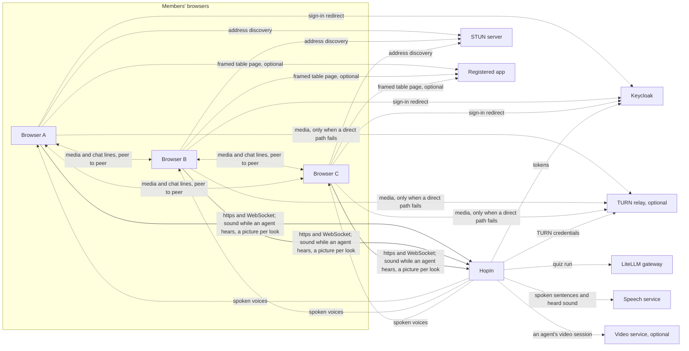
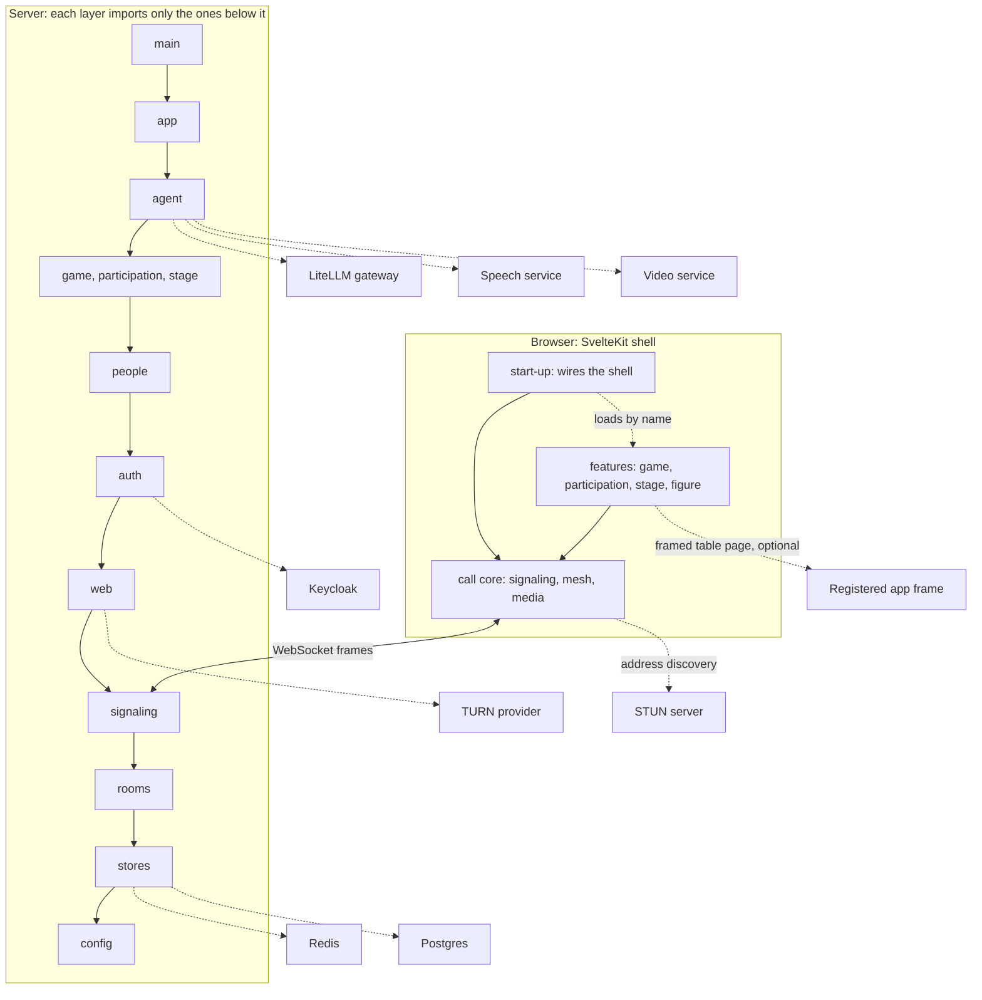
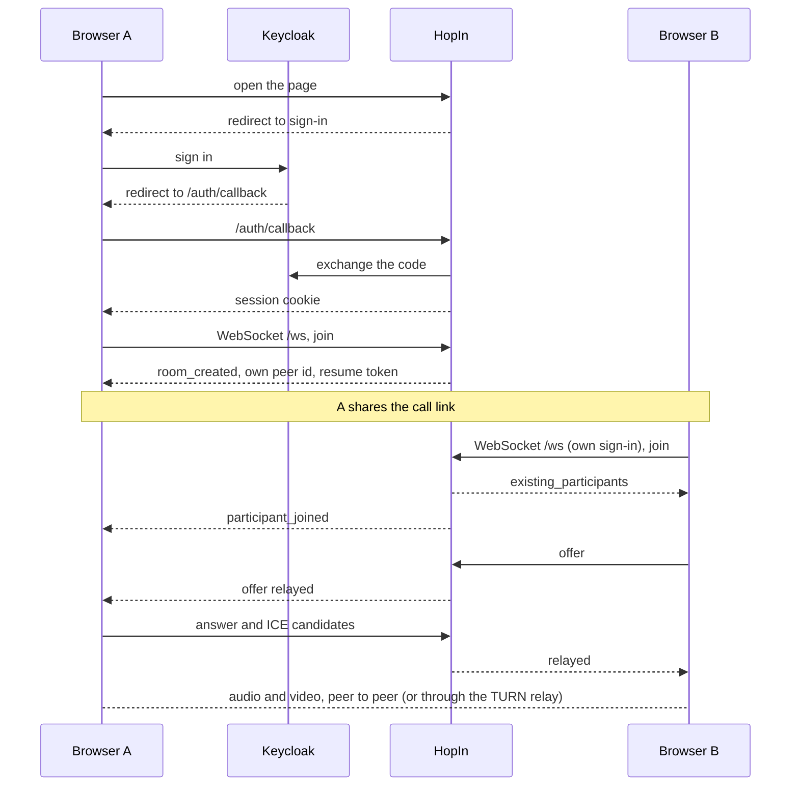
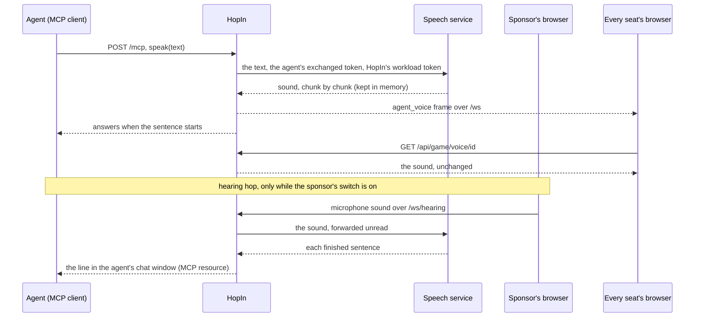

# HopIn Architecture

How HopIn is built, how a call runs and what it trusts. For what HopIn is and how to run it, see the [README](../README.md). Each package states its rules in its docstring or header; a call's rules, each with its test, are in [docs/call.md](call.md).

## 1. Context and Scope

A call is a full mesh: every browser sends its media straight to every other browser, or through a TURN relay when the operator switches it on and a direct path fails. Camera video and sound between people never pass the server. Three other things do: the spoken sentences of the game master and the agents, which the server has the speech service render and serves to each browser; while an agent hears a person, that person's microphone sound, forwarded unread to the speech service; and, when an agent the person lets see looks, one still picture of their camera, held in memory until the agent has it. The server signs people in, hands out rooms and relays setup messages and media state within a room; chat lines and posted files go from browser to browser over data channels of the mesh (a file on a channel of its own), and only while an agent is joined does a page also send its lines to the server; no file ever reaches the server.

Caption: who talks to whom, from `auth/`, `web/turn_relay.py` and `agent/`. A chat line or file between people passes no hop but the mesh's data channels, never HopIn. The session gate (`auth/gate.py`) guards every route and `/ws`.

## 2. Building Block View

Caption: what each part may import, from the `layers` contract in `pyproject.toml` (`errors` and `words` stand in the bottom layers) and `frontend/src/lib/`. A dashed arrow leaves HopIn.

| Package | Job |
|---|---|
| `config` | settings, constants, enums and the secret-file reader |
| `stores` | the Redis every process shares, the ports `create_app` takes (`SharedStores`, `IdentityStores`), and the Postgres engine, its schema, `hopin migrate` and the accounts and sessions |
| `rooms` | rooms, participants, the places people and agents share, the lock |
| `signaling` | the WebSocket: identity, frames, seats, replay, timers, the feature port |
| `web` | the page build, the request's language, health, the ICE server list |
| `auth` | sign-in against Keycloak through webauth, built once by `WebAuth.build` before the routes and installed by `auth.install` after the last, and the session gate |
| `people` | the admin export and erasure of what HopIn holds about one person |
| `game` | optional: one quiz per call |
| `participation` | optional: the agents a person dials in or calls, with no AI in it; `agents.calling` decides the call and the end of an invitation |
| `stage` | optional: the table of a registered app that a call shows, and its start link `/c/new`, which sends a member to the open call showing a table or starts one |
| `agent` | optional connector: the MCP surface of a person's agents and the quiz agent; the only speaker to LiteLLM, the speech service and the video service |
| `app` | the composition root: wires the packages, names no feature |
| `main` | starts the server and switches the optional features in |

The feature port is `TransitionFeature` in `signaling`: each optional feature plugs into it and runs on transitions, so the call core compiles and runs without any of them. The call core and the features commit through one store, and the commit is the only writer of rooms, seats and seat logs; a seat's log never holds its resume token. The browser mirrors it: `GET /api/call-features` names the wired features, and the shell imports them before signaling connects.

`make frontend` builds the page into `src/hopin/web/build/`; the server refuses to start without it.

## 3. Runtime View

An agent's turn, from the MCP tool to the people who hear it, and the other way round:

Caption: from the `agent/` and `participation/` packages.

The rules of a room (host, lock, resume window, host grace, stage table, quiz run, hearing hop, speaking queue) are in [docs/call.md](call.md). The frames are in `src/hopin/signaling/__init__.py`; the limits are constants in `config/constants.py`.

## 4. Deployment View

One container, built from `Dockerfile`, runs as the one pod of the `hopin` namespace on the platform (k3s with Flux) from its attested private GHCR image. The platform's repository owns the manifests under `apps/hopin/`, which hold the live settings; secret files come from `platform-secrets` under `/run/secrets`. The Cloudflare tunnel terminates https and runs through Traefik to HopIn on 8080; readiness is `GET /health`. Keycloak's back-channel logout reaches HopIn there: the platform's realm names `/auth/backchannel-logout` for the `hopin` client and the pod admits Keycloak's pods to it.

Every process reaches one Redis at `HOPIN_REDIS_URL`, holding the rate limit windows and the agent connector's member-place signals; the server refuses to start without it and `/health` is not ready while it does not answer. Every process also reaches one Postgres at `HOPIN_DATABASE_URL`, whose schema (`accounts` and `sessions`) `hopin migrate` brings to the image's head under an advisory lock, so concurrent init containers wait for one another; migrations only expand. `hopin serve` refuses to start on a database that is not at that head and `/health` is not ready while the database does not answer. Accounts and sessions live there, so a sign-in survives a restart and every process admits the same session; all other state lives in memory, so a restart ends every call.

## 5. Crosscutting Concepts

**Sign-in and sessions.** webauth runs the OIDC code flow against Keycloak and the gate admits the members of the login group `REALM_LOGIN_GROUP` names (`src/hopin/auth/__init__.py`). The accounts and sessions live in HopIn's Postgres behind `IdentityStores`, the one port `create_app` takes (`stores/identity.py`): sessions are webauth's Postgres session store, accounts are `stores/accounts.py`, and each sign-in entry holds an advisory lock so entries of every process run one at a time. A back-channel logout ends every session of the person and keeps the account.

**Limits.** Request budgets, the body cap and the origin check are webauth's, set in `config/web_policy.py`; Redis holds the windows.

**Headers.** webauth's Content-Security-Policy with the build's script and style hashes, a Permissions-Policy and the build's cache rules (`web/page_build.py`).

**Persistence.** Only the accounts and sessions in Postgres, Redis's rate limit windows and the connector's place records outlast a restart; rooms, seats and replay logs live in process memory. docs/person-data.md says what HopIn holds about a person.

**Deadlines.** Every timer that outlives a connection is a named deadline behind the `Deadlines` port (`signaling/scheduler.py`). **Logging.** Conventions are in the docstring of `src/hopin/main.py`.

**Proof.** Python tests under `tests/` judge logic per package; Vitest judges the browser's logic; Playwright tests drive the built page, the start-up module and the `.svelte` files; the shared-stores job runs two processes against one Redis and one Postgres and webauth's checks for store adapters against the Postgres accounts and sessions. CI merges their coverage and judges it at 100 %. Import-linter contracts and `make wire-check` prove structure, and the removal drill (`scripts/remove_feature.py`) proves the call survives the deletion of the game and of Skat. [docs/call.md](call.md) maps each rule to its test.

### Trust

Each line: what the party sees and what HopIn trusts of it. 

- **A member's browser** sends media state and connection descriptions with a session, its chat lines to the other browsers over the mesh's data channel and a posted file over a channel of its own, and its chat lines, never a file, to the server only while the page shows a joined agent, as `line_for_agents`, which the server checks (1 to 600 characters, a burst of ten lines then one a second per seat) and drops when no agent is joined; HopIn trusts none beyond the session: names come from the Keycloak account, senders are server-minted peer ids, host actions are checked against the account. It reports why an agent's figure ended as one of five closed codes only, which HopIn checks against the set and logs with ids. At a hold, a member's browser reports how far the held sentence played, a number HopIn checks as finite and not negative, bounds by its own clock and only logs.
- **Another member's file** is trusted with nothing before the receiving page has checked it: the announced name, size and type are the sender's word, so the page sanitizes the name, refuses a file over the per-file cap, one while the same sender has another in flight and one beyond its total received bytes (`FileLimits` in `config/constants.py`), and shows a picture only when its first bytes are a PNG, JPEG, GIF or WebP, and plays a song or video only when its first bytes are an MP3, AAC, M4A, MP4, MOV, WebM, Ogg or WAV container the browser can decode, in a blob typed as that media type. Everything else, an SVG included, is a download of a blob typed `application/octet-stream`, never opened in the page. A song or video is decoded by the browser's own media stack, which is the attack surface the container check narrows and does not remove; it never starts by itself. The page's CSP already admits `blob:` for images and media. The files stay in the receiving page's memory and are released at leave and at the call's end; the TURN relay, when it carries them, bills the operator for the bytes it relays, bounded by the caps.
- **Anyone without a session** reaches the sign-in routes and a few static files only (`auth/gate.py`); HopIn trusts nothing they send.
- **Keycloak** decides who is a member and admin; HopIn trusts its signed tokens from the one issuer, and its logout token to end sessions, so that route stays off the public internet. The session row holds each login's ID token and refresh token, both secrets, in plain text, and the session id only as its SHA-256. Three residuals follow: a database dump together with the client secret renews access until the Keycloak session ends, backups keep the tokens of ended sessions (a deleted row stays in them up to three months), and a copied ID token allows a logout without a prompt.
- **The proxy hops** in `HOPIN_TRUSTED_PROXIES` are trusted to state the person's address in `X-Forwarded-For`; empty trusts none.
- **The other members of a call** see each other's addresses and relayed frames, and read each other's lines, which reach them end to end under DTLS, so neither HopIn's server nor the Cloudflare tunnel in front of it sees a line unless an agent is joined; the parties who deliver the page, HopIn's server (its operator, or an intruder in it) and Cloudflare's tunnel, can still swap the relayed connection descriptions with their DTLS fingerprints, or change the page's script, and read along, a risk HopIn leaves as the mesh's media has it, and it shows no safety code because the same parties would deliver the code; they cannot address people outside their room or act as host.
- **The STUN server** learns each asking browser's address; a wrong answer at worst prevents a connection.
- **The TURN provider** sees who connects to whom, when and how much, never media content; HopIn trusts only its credential answer, over https, and it bills the operator.
- **Each registered app's frame** (`HOPIN_STAGE_APPS`) is a sandboxed page of another origin; it cannot use camera, microphone or screen, and HopIn reads from it only a checked `ready`. The operator's registry is the only source of origins the page may frame.
- **A person's own agent** reaches only `/mcp` with a realm token checked for issuer, audience, `azp`, scope and group, as a plain `user` with no host or admin right; HopIn trusts it to join its person's call, write a bounded line, read the chat and leave.
- **An agent with an account of its own** is trusted for its standing alone: it accepts only an invitation an adder opened for it and never adds or hosts. Its token exchanged for the speech audience is held in memory; with the video on, a token exchanged for the video audience alone at its accept opens its video session and is held nowhere.
- **A figure source** (`HOPIN_FIGURE_SOURCES`) is a host the operator allows; HopIn sends it one credential-less GET for a figure, a clip or a persona's room and trusts none of the answer beyond the size bound (4 MiB for a room), the named sha256 and a glTF header; the source decides where its one redirect to https goes.
- **The LiteLLM gateway** receives per run HopIn's key, the quiz prompt, the given answers with players' names and the tapper's fingerprint; HopIn trusts one cut line from it, shown as text.
- **The speech service** is the operator's own, on an isolated network over plain HTTP; it receives a line's text, the starter's or agent's token, HopIn's workload token and, while an agent hears, a member's microphone sound. HopIn trusts it to answer one bounded sound and serves that unchanged.
- **The video service** (`HOPIN_VIDEO__ORIGIN`) is the operator's own, on an isolated network over plain HTTP; it receives an agent's token exchanged for the video audience alone, HopIn's workload token and a TURN credential for the relay it is to use. HopIn trusts only its events and its health, never what the session shows. It holds the card's one place for a session's whole length, which is the agent's place in the call.
- **The shared Redis** is trusted to hold the windows and answer; it has no password and only the `hopin` namespace reaches it; whoever reaches it could read counted addresses or clear a budget.
- **The shared Postgres** is trusted to hold the schema and answer; HopIn's user has the one database, the URL carries no password and the engine hides statement parameters and logs no statement, so neither a password nor a session token reaches a log or an error line.
- **The operator's settings and secret files** are trusted fully; secrets are read from files and never enter the environment.

## 6. Constraints and reasons

- The import-linter contracts hold the dependency direction between packages, so a new top-level module needs a layer decision, and the game and the stage can be deleted without touching a contract.
- HopIn's own markup holds no inline script, `<style>`, `style=` or `on*=` attribute: the page runs under webauth's policy, which admits only the SvelteKit bootstrap script and the announcer style by hash.
- The wire tokens have one owner each in Python, and `make wire` generates the TypeScript, so a drifting token fails `make wire-check`.

## 7. Not chosen

- A media server (SFU) instead of the mesh: the server relays no call media and needs no media bandwidth; a call size the mesh upload cannot carry reopens it.
- Rooms, seats and replay logs in a database: they are lost on restart by design; calls that must survive a restart, or a second instance sharing them, reopen it.
- An app as a web component, or HopIn and an app linked server to server: the sandboxed frame keeps the app's code and sign-in out of HopIn's page and needs no shared secret; a table that must start from the call, not from a pasted link, reopens it.
- An agent service between HopIn and the LiteLLM gateway: HopIn reaches the gateway directly through the `overnightworks-agents` package; a second consumer needing the same agents, or a tool-running agent that must not run in HopIn's process, reopens it.

## 8. Risks and Technical Debt

- Mesh upload grows with every participant, so a call is capped at `MAX_PARTICIPANTS_PER_ROOM`; with TURN off, calls on networks that block direct paths cannot connect.
- TURN costs money and stops slowly: HopIn sets no cap of its own (the provider's usage alert is the guard), and a credential handed out stays valid at the provider up to 12 hours.
- Whoever delivers the page, HopIn's server with its operator and Cloudflare's tunnel, can read people's lines, files and media by swapping the relayed fingerprints or the page's script; no safety code closes this, because those parties would deliver it, and only an app installed apart from HopIn would, which the vision rules out.
- The agent link has no receipts: a line for the agents shows delivered once handed on, and the server drops one beyond a seat's budget, or when no agent is joined, without telling the page. The page paces its lines to the budget, holds them while the socket is cut and charges the lines a resume writes again, but it cannot see when the server counts a line: a socket that dies unnoticed or stalls and then delivers its frames together can bring more than a burst at once, and the server drops the rest, so a line for the agents may be lost then. Only a server receipt for the agent link closes this; it waits for usage evidence.
- A file is sent once to each person, so a sender's upload grows with the people in the call times the per-file cap; it is fetched only while the sender stays, and a later joiner or a page that reloads gets nothing earlier. A receiver's memory holds up to the total received-bytes cap.
- A restart ends every call; sessions survive it.
- Redis is a hard dependency with no in-memory fallback, because a fallback would grant each process the full budget again: while it does not answer, budgeted routes answer `503` and `/health` is not ready, so HopIn is down for everyone; calls in memory survive.
